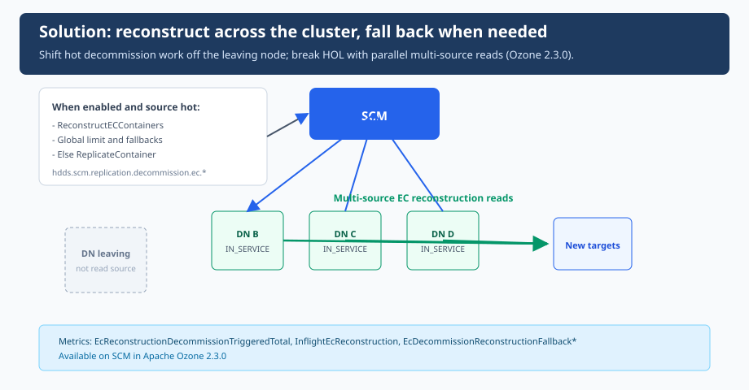

You run `ozone admin datanode decommission`. The node flips to **DECOMMISSIONING**. You expect a few hours of background copying, then a clean shutdown.

Instead you get **days**.

Recon and the admin CLI show the same stubborn picture: hundreds or thousands of **under-replicated EC containers** still tied to that host. The count moves, but glacially. Other Datanodes look bored. The cluster is big; the decommission is not.

So you ask the obvious question: *We added nodes. Why doesn't decommission get faster?*

That question has a precise answer for EC—and a fix landing under epic [HDDS-15014](https://issues.apache.org/jira/browse/HDDS-15014).

<!-- truncate -->

## Two traps, one slow decommission

EC decommission felt stuck for **two separate reasons**. Fixing it meant addressing **both**.

### Trap 1: The decommissioning node is always the source

For EC during decommission, SCM's classic recovery path is **1:1 container replication**: copy the replica that lives on the leaving node to a new home.

For a given EC stripe, the replica on the decommissioning Datanode is the one that must be replaced. A **ReplicateContainer** job for that index reads **from that node**. It does not matter whether you have ten Datanodes or a thousand: **every such copy still pulls bytes off the host you are trying to drain**.

Adding Datanodes gives you more **targets** and more **placement** options. It does **not** give you more **sources** for copying each stripe off the `decom` node. The decommissioning Datanode remains the **choke point** for that work.

### Trap 2: Head-of-line blocking on that choke point

The second trap is queueing on the same machine.

Thousands of EC containers may need copies before decommission can finish. Each 1:1 replicate consumes queue slots, disk concurrency, and network on **one** source. New work waits behind work already scheduled: classic **head-of-line (`HOL`) blocking**.

You get a double bind:

1. **Architectural:** replication tasks are anchored to the `decom` node as source.
2. **Operational:** those tasks stack up on that node's pipeline and disk.

More Datanodes do not break either lock by themselves.

## The way out: reconstruct across the cluster

Epic [HDDS-15014](https://issues.apache.org/jira/browse/HDDS-15014) changes **what** SCM schedules when the `decom` node is saturated, not by pretending one replication source can scale with fleet size.

**Shift work from replicate to reconstruct.** **EC reconstruction** rebuilds missing indexes from **several surviving fragments on other Datanodes**. SCM **offloads** the decommissioning node as a reconstruction source when enough healthy **IN_SERVICE** fragments exist elsewhere. That eases Trap 1: recovery no longer means reading every stripe from the node we are evicting.

**Break head-of-line on the hot path.** When the `decom` Datanode's replication **load** crosses a threshold, SCM may switch decommission-only indexes from 1:1 replicate to reconstruction. Parallel reconstruction across the fleet replaces a long **single-source** queue with work that does not all wait on one outbound pipe, targeting Trap 2.

If reconstruction is not viable (insufficient sources, overloaded targets, placement failure, or a **global reconstruction cap**), SCM **falls back to 1:1 replication**. Safety stays; you only take the fast path when the cluster can support it.

Implementation: [HDDS-15071](https://issues.apache.org/jira/browse/HDDS-15071) (configuration and global reconstruction limit), [HDDS-15072](https://issues.apache.org/jira/browse/HDDS-15072) (load-based switching and source offloading), [HDDS-15075](https://issues.apache.org/jira/browse/HDDS-15075) (metrics). Related discussion in the broader ecosystem: [HDFS-16874](https://issues.apache.org/jira/browse/HDFS-16874).

## Configuration

All keys are on SCM Replication Manager configuration, **reconfigurable**, and conservative by default:

| Property | Default | Role |
|----------|---------|------|
| `hdds.scm.replication.decommission.ec.reconstruction.enabled` | `false` | Enable load-based switch from replicate to reconstruct for EC decommission. |
| `hdds.scm.replication.decommission.ec.reconstruction.load.factor` | `0.9` | Treat `decom` source as hot when queue is at least this fraction of its effective replication limit. |
| `hdds.scm.replication.reconstruction.global.limit` | `0` | Cluster-wide inflight EC reconstruction cap (`0` = unlimited). |

**Rollout:** deploy metrics, set a sensible global limit, enable on a canary decommission, then watch whether reconstruction is actually triggered or you live in fallback counters.

## Metrics

On SCM **`ReplicationManagerMetrics`**:

**Gauges:** `InflightEcReconstruction`, `EcReconstructionGlobalLimit`

**Decommission path:** `EcReconstructionDecommissionTriggeredTotal`, `EcReconstructionGlobalLimitReachedTotal`

**Fallback (why 1:1 replicate won):** `EcDecommissionReconstructionFallbackInsufficientSourcesTotal`, `EcDecommissionReconstructionFallbackTargetOverloadedTotal`, `EcDecommissionReconstructionFallbackNoOpTotal`

**Related:** `EcReconstructionCmdsSentTotal`, `EcReconstructionCmdsDeferredTotal` (global send-time deferral)

If `EcReconstructionDecommissionTriggeredTotal` stays flat while fallbacks climb, you are still in the replicate-from-`decom` world. Tune limits and load factor; do not assume fleet growth alone fixes decommission.

## Bottom line

EC decommission was slow because **every stripe copy was tied to the leaving node as source**, and **those copies piled up in one queue**. The fix is to **move some recovery to reconstruction** (multi-source, off the `decom` node) when that node is the head of the line, with caps and safe fallback.

**References:** [HDDS-15014](https://issues.apache.org/jira/browse/HDDS-15014). Ozone PRs [#11054](https://github.com/apache/ozone/pull/11054), [#11450](https://github.com/apache/ozone/pull/11450), [#11557](https://github.com/apache/ozone/pull/11557)
