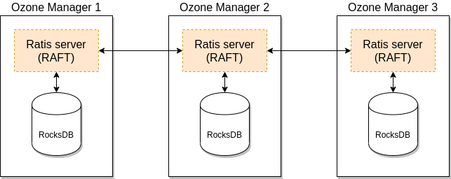

# Ozone Manager High Availability

Ozone has two metadata-manager nodes (*Ozone Manager* for key space management and *Storage Container Manager* for block space management) and multiple storage nodes (Datanode). Data is replicated between Datanodes with the help of RAFT consensus algorithm.

To avoid any single point of failure the metadata-manager nodes also should have a HA setup.

Both Ozone Manager and Storage Container Manager supports HA. In this mode the internal state is replicated via RAFT (with Apache Ratis).

This page explains the HA setup of Ozone Manager (OM). Please check the [SCM High Availability](./scm-ha) page for SCM HA. While they can be setup for HA independently, a reliable, full HA setup requires enabling HA for both services.

## How It Works

A single Ozone Manager uses [RocksDB](https://github.com/facebook/rocksdb/) to persist metadata (volumes, buckets, keys) locally. HA version of Ozone Manager does exactly the same but all the data is replicated with the help of the RAFT consensus algorithm to follower Ozone Manager instances.

Client connects to the Leader Ozone Manager which processes the request and schedules the replication with RAFT. When the request is persisted to the Raft logs of a majority of voting OMs, the leader can return with the response.

## Fault tolerance

OM HA group can have more than three voting members. Raft requires a majority of voting members to elect a leader and commit requests:

| Voting members | Majority required | Failures tolerated |
| --- | --- | --- |
| 2 | 2 | 0 |
| 3 | 2 | 1 |
| 4 | 3 | 1 |
| 5 | 3 | 2 |
| 6 | 4 | 2 |

An even number of voting members works, but adds no failure tolerance compared with the preceding odd number. Three voting members tolerate one failure; five tolerate two, allowing one node to fail while another is down for maintenance. Deploy voting members on independent hosts. Listener OMs do not count toward the voting majority or increase failure tolerance.

## Learn More

- **Configuration**: For detailed configuration instructions on setting up OM HA, see the [OM HA Configuration](../../administrator-guide/configuration/high-availability/om-ha) documentation.
- **Read scaling**: To add read-only, non-voting OM replicas (Listener OMs), see [Listener OM](../../administrator-guide/configuration/high-availability/listener-om).
- **Migrating OM hosts**: For configuration-based and DNS-based host replacement procedures, see [OM migration approaches](../../administrator-guide/operations/node-decommissioning-and-maintenance/om-migration).

- **Implementation Details**: For in-depth technical details about the OM HA implementation, including the double buffer approach and automatic snapshot installation, see the [OM HA Implementation Details](../../system-internals/components/ozone-manager/high-availability) documentation.
