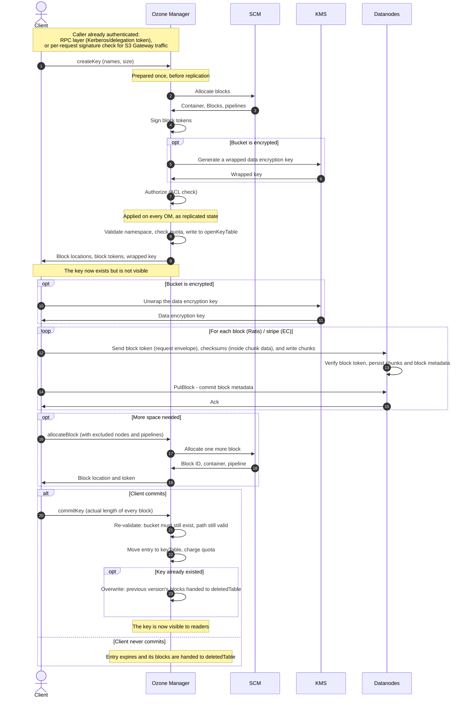
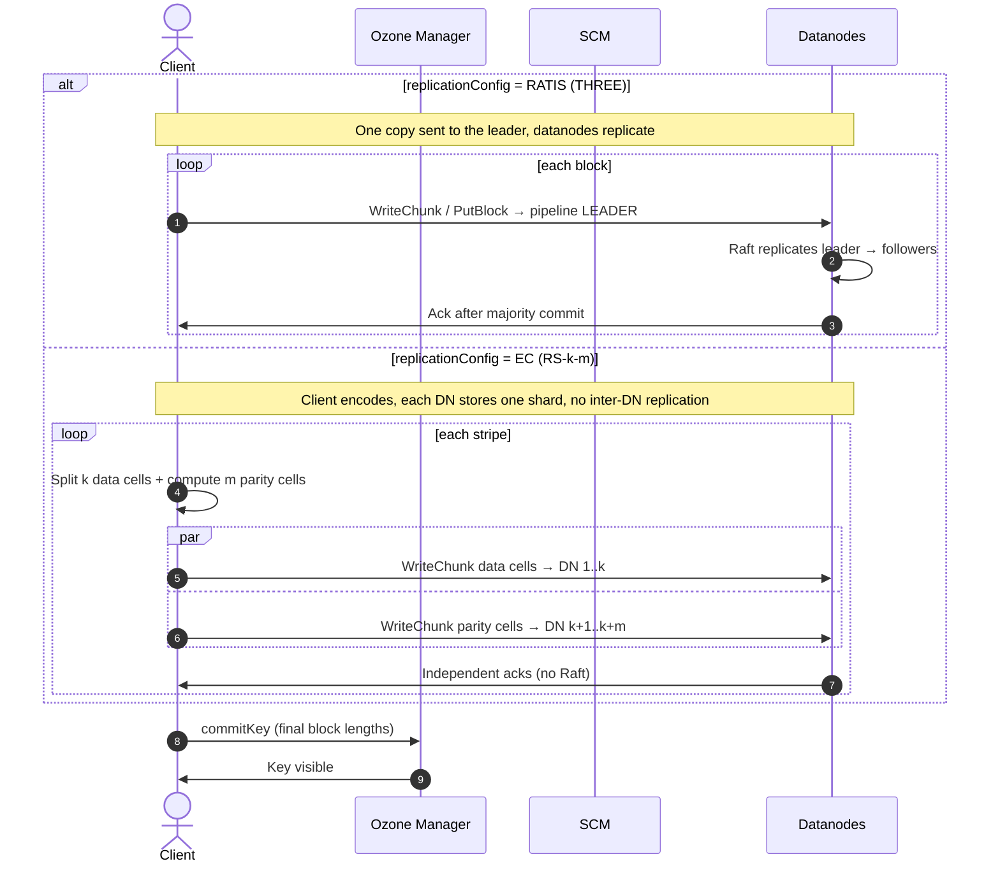

# Implementation of Write Operations

A write in Ozone is a **reservation**, a **data transfer**, then a **commit**. The Ozone Manager (OM) reserves a name and hands back a set of block locations; the client streams the bytes straight to the Datanodes; only when the client reports back does the key become visible. Neither OM nor the Storage Container Manager (SCM) ever sees the data itself.

This mechanism leads to two consequences:

- **A key is invisible until it is committed:** In the ordinary path, there is no partially visible key.
- **An abandoned write leaves something behind:** Blocks were reserved and bytes may already sit on the Datanodes, but no key accounts for them and the bucket's quota does not count them either, since space is only charged at commit. A background cleanup service reclaims those abandoned entries once they are older than a configured threshold.

## The Write Path at a Glance

---

## Phase 1: Reservation (Client, OM & SCM, KMS)

Nothing in this phase touches data. The client and OM agree on a name, and OM works out where the bytes will eventually go.

### 1.1 Initiate the Request

The application calls `OzoneBucket.createKey(key, size)`, which delegates to `RpcClient` (the `ClientProtocol` implementation). `RpcClient` builds an `OmKeyArgs` and calls `openKey(OmKeyArgs)` on its `OzoneManagerProtocolClientSideTranslatorPB` proxy (`OzoneManagerClientProtocol` implementation). It sends an `OMRequest` of `Type.CreateKey` and wraps the returned `CreateKeyResponse` into an `OpenKeySession` holding the session ID, the key info and the open version.

The client asks OM to open a key with a request that carries the key name, the expected data size, and a replication config (if the caller or the bucket specifies one). The OM server resolves replication in the order: client, then bucket default, then the OM server default of "RATIS" with replication factor "THREE".

### 1.2 OM: Authentication Check

This is active only in secure mode (`ozone.security.enabled=true`).

Hadoop RPC SASL verifies either a Kerberos ticket or an OM delegation token at the RPC server (`ipc.Client`/`ipc.Server`). The OM RPC server is built with the delegation token secret manager attached, so token authentication is handled by the SASL layer before the request reaches any OM handler.

### 1.3 OM (Leader): PreExecute and Replicate to the Follower OMs

1. **Entry Point:** `OzoneManagerProtocolServerSideTranslatorPB.submitRequest(...)`
2. **Pre-dispatch checks**, before the write flow starts:
   1) Validate the request
   2) If the request carries `S3Authentication`, validate S3 credentials.
   3) Reject the request if this OM is not the leader.
   4) Return the cached response immediately if there is cached response in the Ratis retry cache so that the request is not re-executed.
3. **Routed to `OMExecutionFlow`**, which performs the pre-replication work:
   1) Switches on the command type and constructs the concrete request object. For `CreateKey` on an OBS bucket this is `OMKeyCreateRequest`; an FSO bucket gets `OMKeyCreateRequestWithFSO` instead, chosen by bucket layout.
   2) Calls `preExecute(...)` on the request object from previous step, which:
      - Validate and normalize the key path
      - Resolve which replication config to use
      - Ask SCM to allocate blocks, then signs a block token for each. See [1.3.1](#131-allocate-and-sign-blocks).
      - Generate the wrapped encryption key if the bucket is encrypted. See [1.3.2](#132-om--kms-key--encryption)
      - Authorize the request. See [1.3.3](#133-om-authorization-check)
      - Mint the client identifier
   3) Submits the rewritten request to Ratis to replicate. See [1.4](#14-om-replicate-validation-and-write-into-the-openkeytable)

For the logic in processing write requests, OM splits each write request into two parts:

- The **non-deterministic part** (step 3.2 in the above): It runs exactly once on the leader OM that received the request, before the request is replicated.
- The **deterministic part** is `validateAndUpdateCache` (see [1.4](#14-om-replicate-validation-and-write-into-the-openkeytable)): It runs on every OM as a replicated state machine step. This part must be deterministic, because every OM has to reach the same result independently.

Anything that cannot be repeated identically has to happen in `preExecute`. See [Ozone Manager high availability](../components/ozone-manager/high-availability) for the replication machinery itself.

#### 1.3.1 Allocate and Sign Blocks

Before asking SCM, OM calculates the `dataGroupSize` and `numBlocks`. OM then asks SCM where blocks should be allocated. SCM replies with a list of `AllocatedBlock`, each containing:

- `Pipeline`: Represents the group of Datanodes which store the container.
- `ContainerBlockID`: Including ContainerID and localID.

After getting the allocated block, in a secure cluster with block tokens enabled (`hdds.block.token.enabled=true`), OM also signs a short-lived **block token** for each allocated block, scoped to that blockID with read-write access, using secret keys that SCM generates and rotates. This is what lets a client write directly to a Datanode that has never heard of the request: the Datanode validates the token's signature against the secret key which it fetches from SCM and caches, rather than making a round trip to OM on every write. See [Tokens](../security/tokens).

#### 1.3.2 OM & KMS: Key & Encryption

To generate `FileEncryptionInfo`, if a KMS provider is configured, OM reads `OmBucketInfo` from its bucket table. If the bucket carries a `BucketEncryptionKeyInfo`, OM asks KMS to generate an Encrypted Data Encryption Key (EDEK) for that key name. OM then combines the two into a `FileEncryptionInfo`.

#### 1.3.3 OM: Authorization Check

Write requests authorize in `OMClientRequest.checkAcls()`. `checkAcls()` delegates to `OzoneAclUtils.checkAllAcls()`, which varies the check by resource type:

- **VOLUME**: a single check with the volume owner as `{OWNER}`.
- **BUCKET/KEY/PREFIX**: a single check if the caller is the volume owner. Otherwise two checks: first, the parent volume with the volume owner as `{OWNER}`, then the resource itself with the bucket owner as `{OWNER}`.

### 1.4 OM: Replicate Validation and Write into the `OpenKeyTable`

With the non-deterministic work already done, the OM leader hands the request to the Ratis `RaftServer` via `server.submitClientRequestAsync(raftClientRequest)`. Every OM then independently applies the checks that decide whether the key may exist.

1. **Entry Point**: `OzoneManagerStateMachine.applyTransaction(...)`
2. **Validate Namespace**: The volume and bucket must exist, or the request fails with `VOLUME_NOT_FOUND`/`BUCKET_NOT_FOUND`. For bucket layouts with filesystem semantics, the path must not collide with an existing directory, and any missing parent directories are created inside the same transaction rather than as separate operations.
3. **Validate Key Existence**: If the key already exists with a specific generation, the key must exist with matching updateID and update KeyArgs with expectedDataGeneration set. Otherwise, an `OMException` is thrown.
4. **Check Quota**: Byte quota is **checked here, not charged**. OM compares the bucket's used space against the size of the blocks being reserved and rejects the write if it would not fit, so a write can be rejected before a single byte moves. But nothing is recorded: an open key adds nothing to the bucket's usage, which means concurrent open writes do not reserve against one another. Several clients can each pass this check and collectively overshoot the quota, and the overshoot only surfaces at commit, where the check runs again. See [Implementation of Quota](./quota).
5. **Write to the OpenKeyTable**: The reservation is recorded in `openKeyTable`, keyed by the key name plus the client identifier. That extra component is what allows several clients to have concurrent, uncommitted writes to the same name without colliding. It is deliberately a different table from `keyTable`, because reads never consult it.

---

## Phase 2: Encryption Setup (Client & KMS)

This phase covers getting the encryption key and creating the `OzoneOutputStream`. The client receives an `OpenKeySession` from OM and uses it to initialize an output stream based on the encryption key.

- If the bucket is encrypted:
  1. Retrieve key by `getDEK(...)`. The handle returned in phase 1 carries a wrapped data encryption key, which OM obtained from the Key Management Server (KMS) while preparing the request. The client sends the wrapped key back to the KMS itself. The KMS performs its own authorization check and returns the raw data encryption key to the client.
  2. Create `OzoneOutputStream` with `CryptoOutputStream`.
- Else if GDPR is enabled:
  1. The client uses `getGDPRSymmetricKey(...)` to reconstruct the cipher from metadata retrieved from `OpenKeySession`. This is how Ozone supports General Data Protection Regulation (GDPR) erasure.
  2. Create `OzoneOutputStream` with `CipherOutputStreamOzone`.
- Otherwise:
  1. Default bucket with no encryption key.
  2. Create a plain `OzoneOutputStream`.

In the first two cases, everything leaving the client is already encrypted; for a default bucket the bytes leave as plaintext.

---

## Phase 3: Data Transfer (Client & Datanode)

The application calls `OzoneOutputStream.write(data)` to write data to Datanodes directly. The `OzoneOutputStream` is the object built from `OpenKeySession` from OM with block locations and tokens, so that the client writes to the Datanodes without involving OM again unless it needs more blocks.

### 3.1 Client: Prepare and Send a Write

When an application calls `OzoneOutputStream.write(data)`, the call passes through a short stack of streams. `KeyOutputStream` picks the block, `BlockOutputStream` turns bytes into chunks for that block, and an `XceiverClient` sends the request to Datanodes.

`KeyOutputStream` (with `BlockOutputStreamEntryPool`)

1. Picks the current block entry. If that entry is closed, the pool advances to the next pre-allocated block. When no blocks are left, it calls OM to allocate new blocks.
2. Ensures each write at current block and calculates the remaining capacity of the block. Once the current block is full, it closes the entry via `handleFlushOrClose(StreamAction.FULL)` so the next write moves to a new block.

`BlockOutputStream`

1. Put data into `currentBuffer`, an instance of `ChunkBuffer` which is the buffer for a block chunk.
2. When `currentBuffer` is full, writes it as a new chunk and records the chunk information for a later `PutBlock` call.
   1. Computes a checksum over the chunk and attaches it to the `ChunkInfo`.
   2. Validates the new chunk's offset against the previous chunk's offset; the write fails on a mismatch.
   3. With incremental chunk list enabled, rebuilds the trailing partial chunk entry in the container block data; otherwise, appends the chunk to it.
   4. Sends the chunk with `writeChunkAsync` through the `XceiverClient`, whose implementation depends on the replication configuration. (`XceiverClientRatis` for `RATIS`; `XceiverClientGrpc` for `STAND_ALONE`; `ECXceiverClientGrpc` for EC)
3. Sends `putBlockAsync` to publish the block's chunk list.

| Layer | Responsibility |
| --- | --- |
| KeyOutputStream | Tracks which block is current and asks for more |
| BlockOutputStream | Buffers, chunks, and checksums the data for one block; talks to one pipeline |
| XceiverClient | Sends requests to the Datanodes |

### 3.2 Datanode: Verification and Persistence

#### 3.2.1 replicationConfig = `RATIS` (THREE)

Datanode (Leader)

1. Entry point: `GrpcClientProtocolService.OrderedRequestStreamObserver.onNext(...)`
2. `writeAsync`
   1. check the leader state: only leader proceeds.
   2. Retry cache: returns the cached reply for client retries instead of re-appending.
   3. `ContainerStateMachine.startTransaction(...)` builds the `TransactionContext`:
      - validate the block token, container existence and open state
      - clear the encoded token so it is never logged
      - attach data as state machine data
      - reject `PutBlock`/`WriteChunk` on an already-finalized block
   4. `appendTransaction`
      - append the entry to the local Raft log via `state.appendLog(context)`
      - wake `GrpcLogAppender` via `leaderState.notifySenders` to replicate to followers. `GrpcLogAppender` streams `AppendEntriesRequestProto` over `GrpcServerProtocolClient.appendEntries`.

Datanode (Followers)

1. Entry point: `GrpcServerProtocolService.appendEntries`
2. Log entry to the segment file.

#### 3.2.2 replicationConfig = EC (RS-k-m)

EC does not use Ratis. The client writes each replica index to the corresponding Datanode over standalone gRPC.

Client (`ECXceiverClientGrpc`)

1. Pick up the channel based on the datanodeId
2. Create a new gRPC message stream pair for each call

Datanode

1. Entry point: `GrpcXceiverService.send(...)`
2. Validate the block token on every request
3. Validate the request reached the correct Datanode with the nodeId matching
4. Handle the `WriteChunk` command type
   - validate the chunk checksum, if `hdds.datanode.chunk.data.validation.check` is enabled (default: false)
   - call `ChunkManager` to write to disk
   - if the request carries block metadata (`writeChunk.hasBlock()`), commit it in the same call.

---

## Phase 4: Commit (Client & OM)

Until now the key exists only in `openKeyTable` and the bytes sit on Datanodes that no visible key accounts for. The commit joins the two: the client reports how long each block actually turned out to be, and OM moves the entry into the table readers consult. Like the reservation in phase 1, a commit is itself a replicated OM write, with the same split between work done once on the leader and work repeated on every OM.

### 4.1 Client: Close the Stream and Commit the Key

1. **Trigger point:** the application calls `KeyOutputStream.close()`, which runs `closeInternal()` under the stream's write lock.
2. **Finish the last block:** `handleFlushOrClose(StreamAction.CLOSE)` closes the current block stream: remaining chunks are flushed, the final `PutBlock` is sent, and the call waits for every pending flush to be acknowledged. Earlier blocks were already closed the same way as they filled up. By the time OM hears anything, the Datanodes have acknowledged all the data the client is about to report.
3. **Commit:** `BlockOutputStreamEntryPool.commitKey(offset)` fills in the final key args:
   - `dataSize`: the total length written, asserted to equal the stream's offset.
   - `locationInfoList`: the location info list of written blocks.
4. It sends `Type.CommitKey` with those key args to OM.
5. OM replies with the modification time it stamped on the key.

### 4.2 OM: Apply the Commit

The request travels the same route as `CreateKey` in [1.3](#13-om-leader-preexecute-and-replicate-to-the-follower-oms): `OzoneManagerProtocolServerSideTranslatorPB.submitRequest(...)` → pre-dispatch checks → `OMExecutionFlow`, which constructs the concrete request object (`OzoneManagerRatisUtils.createClientRequest`, switching on `Type.CommitKey`) and calls `preExecute` on the leader before replicating through Ratis. For an OBS or LEGACY bucket the object is `OMKeyCommitRequest`; an FSO bucket gets `OMKeyCommitRequestWithFSO` instead, chosen by bucket layout.

#### 4.2.1 OM (Leader): PreExecution

`preExecute` does the work that can not be repeated independently on each OM:

1. If the commit carries an expected data generation, verify the matching OM feature is finalized: `ATOMIC_CREATE_IF_NOT_EXISTS` for create-if-absent, `ATOMIC_REWRITE_KEY` otherwise.
2. Validate and normalize the key path for the layout.
3. **Authorize** the write: `resolveBucketAndCheckOpenKeyAcls(...)` with `ACLType.WRITE`, resolving link buckets and reading the open key entry for this client id. Same machinery as [1.3.3](#133-om-authorization-check).

#### 4.2.2 OM: Replicate Validation and Move into `KeyTable`

Every OM then applies the commit as a replicated state machine step, entered at `OzoneManagerStateMachine.applyTransaction(...)` and carried out in `validateAndUpdateCache`:

1. **Validate the namespace:** The volume and bucket must still exist.
2. **Record the real sizes:** The data size is taken from the request, the update id is set to the transaction index.
3. **Charge quota:** Phase 1 only *checked* quota; here it is charged. Re-checks against the bucket's byte quota together with one namespace unit, then adds to the bucket's usage.
4. **Apply:** Moves an open key in `openKeyTable` (in-flight writes) into a committed key (in `keyTable`) and later flushes to RocksDB in one batch by the `OzoneManagerDoubleBuffer`.

### 4.3 Cleanup the Writes that Never Commit

If a client crashes, or stops writing without ever committing, the open key row stays behind with blocks that no visible key accounts for.

- A background service `OpenKeyCleanupService`, running on the OM leader, resolves those rows.
  - Each run scans the open table and gets rows whose **creation time** is older than `ozone.om.open.key.expire.threshold`(default `7d`).
  - Delete the rows through a `DeleteOpenKeys` request (`OMOpenKeysDeleteRequest`). See [Implementation of Delete Operation](./delete)

---

## Summary of the Write Path

| Phase | Actors | What moves | State at the end |
| --- | --- | --- | --- |
| 1. Reservation | Client, OM, SCM | Metadata only | Key is in `openKeyTable` with blocks reserved, block tokens signed, and quota checked, invisible to readers |
| 2. Encryption setup | Client, KMS (encrypted buckets only) | The wrapped key, if any | Client holds the data encryption key; plain buckets skip this phase entirely |
| 3. Data transfer | Client, Datanodes | The data | Chunks and block metadata persisted and replicated on the Datanodes. Replicated by Ratis for `RATIS`, written as k+m shards for EC |
| 4. Commit | Client, OM | Actual block lengths | Key is in `keyTable` and visible; quota charged against actual lengths; leftover blocks queued for reclamation |

## Bucket Layouts

The bucket layout changes which tables are involved and how much path handling OM does, but not the shape of the flow.

| | FSO | OBS / LEGACY |
| --- | --- | --- |
| Open table | `openFileTable` | `openKeyTable` |
| Committed table | `fileTable` | `keyTable` |
| Key identity | Parent directory id plus file name | Full key path |
| Intermediate directories | Created as rows in `directoryTable` | LEGACY: created as directory entries in `keyTable` when filesystem paths are enabled. OBS: never created — a key name containing slashes is just a name |
