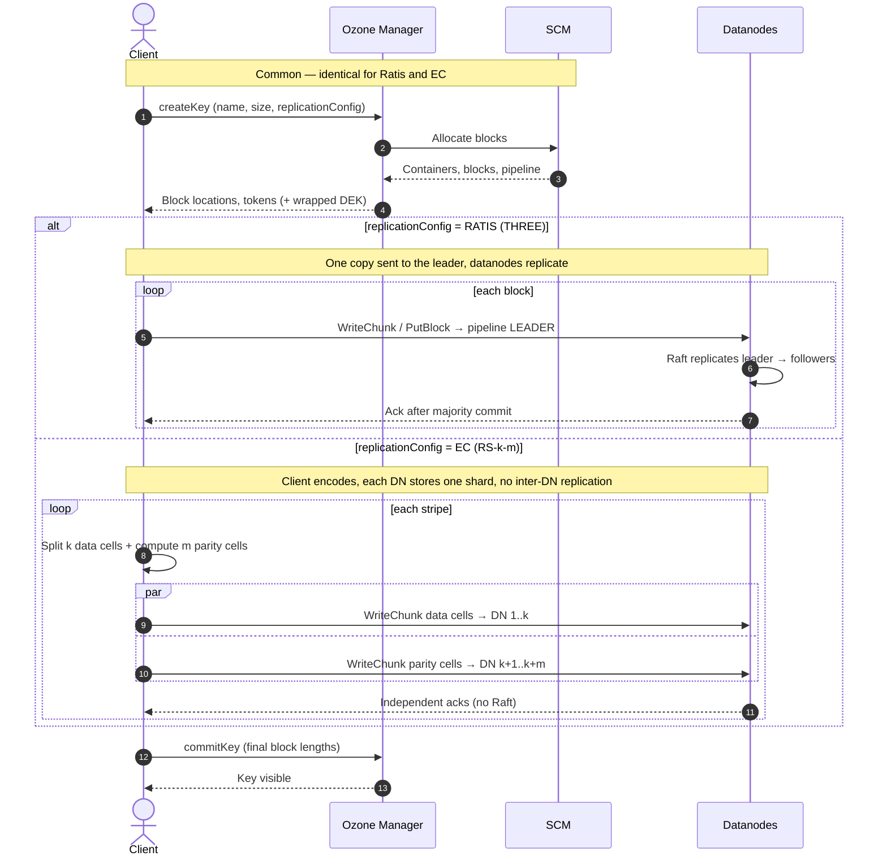

# Implementation of Write Operations

A write in Ozone is a **reservation**, a **data transfer**, then a **commit**. The Ozone Manager (OM) reserves a name and hands back a set of block locations; the client streams the bytes straight to the Datanodes; only when the client reports back does the key become visible. Neither OM nor the Storage Container Manager (SCM) ever sees the data itself.

This mechanism leads to two consequences:

- **A key is invisible until it is committed.** In the ordinary path, there is no partially visible key. (`hsync` is the deliberate exception - see [4.1](#41-committing-the-key))
- **An abandoned write leaves something behind.** Blocks were reserved and bytes may already sit on the Datanodes, but no key accounts for them and the bucket's quota does not count them either, since space is only charged at commit. A background cleanup service reclaims those abandoned entries once they are older than a configured threshold

## The write path at a glance

```mermaid
sequenceDiagram
    autonumber
    actor Client
    participant OM as Ozone Manager
    participant SCM
    participant KMS
    participant DN as Datanodes

    Client->>OM: createKey (names, size, replication)
    Note over Client,OM: Caller already authenticated: <br/>RPC layer (Kerberos/delegation token),<br/> or per-request signature check for S3 Gateway traffic

    Note over OM: Prepared once, before replication
    OM->>SCM: Allocate blocks
    SCM->>OM: Container, Blocks, pipelines
    OM->>OM: Sign block tokens
    opt Bucket is encrypted
        OM->>KMS: Generate a wrapped data encryption key
        KMS->>OM: Wrapped key
    end
    OM->>OM: Authorize (ACL check)

    Note over OM: Applied on every OM, as replicated state
    OM->>OM: Validate namespace, check quota, write to openKeyTable

    OM->>Client: Block locations, block tokens, wrapped key
    Note over Client,OM: The key now exists but is not visible

    opt Bucket is encrypted
        Client->>KMS: Unwrap the data encryption key
        KMS->>Client: Data encryption key
    end

    loop For each block (Ratis) / stripe (EC)
        Client->>DN: Send block token (request envelope), checksums (inside chunk data), and write chunks
        DN->>DN: Verify block token, persist chunks and block metadata
        Client->>DN: PutBlock - commit block metadata
        DN->>Client: Ack
    end

    opt More space needed
        Client->>OM: allocateBlock (with excluded nodes and pipelines)
        OM->>SCM: Allocate one more block
        SCM->>OM: Block ID, container, pipeline
        OM->>Client: Block location and token
    end

    alt Client commits
        Client->>OM: commitKey (actual length of every block)
        OM->>OM: Re-validate: bucket must still exist, path still valid
        OM->>OM: Move entry to keyTable, charge quota
        opt Key already existed
            OM->>OM: Overwrite: previous version's blocks handed to deletedTable
        end
        Note over OM: The key is now visible to readers
    else Client never commits
        Note over OM: Entry expires and its blocks are handed to deletedTable
    end
```

---

## Phase 1: Reservation (Client, OM & SCM)

Nothing in this phase touches data. The client and OM agree on a name, and OM works out where the bytes will eventually go.

### 1.1 Initiating the request

The client asks OM to open a key, supplying the name, the expected size, and the replication it wants. What it gets back is a handle: the block locations OM has already reserved, and a client identifier that scopes every later call belonging to this write.

The expected size is a hint, not a contract. OM uses it to decide how many blocks to reserve up front, capped at a configured maximum. The real length is only known at commit, and a client may write more or less than it announced.

### 1.2 OM: preparing the request before replication

One structural point governs everything OM does on the write path. OM splits each write request into a part that runs **once, on the OM that received it, before the request is replicated**, and a part that runs **on every OM as a replicated state machine step**. The second part must be deterministic, because every OM has to reach the same result independently. So anything that cannot be repeated identically has to happen in the first part, and its results are baked into the request that then gets replicated. See [Ozone Manager high availability](../components/ozone-manager/high-availability) for the replication machinery itself.

That constraint, not the logical order of the operation, is what decides where each step lives.

Before replication, the receiving OM normalizes the path, resolves which replication to use, **asks SCM for blocks**, stamps the modification time, generates the wrapped encryption key if the bucket is encrypted, **authorizes the request**, and mints the client identifier. Authorization runs against the volume, bucket, and key through whichever authorizer the cluster is configured with, Ozone's native ACLs or an external system such as Apache Ranger. With the native authorizer the key's own ACL is skipped on create, since the key does not exist yet, so the decision rests on the bucket and volume above it. Authentication (Kerberos or, for S3, signature) happens at the RPC layer before the request reaches this part. OM only records the authenticated principal into the request so every replica applies it identically. The mechanism is the same one described under authorization in [Implementation of Read Operations](./read).

In a secure cluster, OM also signs a short-lived **block token** for each allocated block, using secret keys that SCM generates, rotates, and distributes to every Datanode. The token names a specific block and grants specific access. This is what lets a client write directly to a Datanode that has never heard of the request: the Datanode validates the token against the shared secret key rather than asking OM. See [Tokens](../security/tokens).

### 1.3 SCM: choosing the pipeline and container

SCM is not on the data path. OM asks it a question — *where should the next block live?* — and SCM answers with an address.

SCM refuses to allocate blocks while it is in safe mode. This is worth knowing because it is one of the most common reasons writes fail across an entire cluster immediately after startup, while reads continue to work.

To answer, SCM picks an open **pipeline**, then an open **container** within that pipeline that still has room, creating either one if none is suitable. A pipeline is a fixed group of Datanodes that replicate together; a container is the unit of storage those Datanodes actually manage, and a block lives inside a container. Because containers are capped, a large key spreads across many blocks, many containers, and often many pipelines.

**Which Datanodes make up a Ratis pipeline is a topology decision, made when the pipeline is created — not per write.** A Ratis THREE pipeline needs three Datanodes, and SCM chooses them through a rack-aware placement policy rather than at random. The policy tries to spread the three replicas across failure domains — favouring Datanodes on different racks so that losing one rack cannot take out the whole pipeline — while also respecting each Datanode's health, remaining capacity, and a cap on how many pipelines it may participate in at once. If the topology has too few racks to satisfy the rule, placement falls back to a best-effort choice rather than failing. Once formed, the pipeline is reused for many blocks and many keys; an individual write simply lands on whichever existing pipeline SCM hands back.

If the client asked for locality, SCM then sorts that pipeline's Datanodes by network distance from the client, so the client writes to the nearest replica first. This ordering is per request and does not change the pipeline's membership.

### 1.4 OM: replicated validation and the open key table

With the non-deterministic work already done, every OM independently applies the checks that decide whether the key may exist:

- **Namespace validation.** The volume and bucket must exist. For bucket layouts with filesystem semantics, the path must not collide with an existing directory, and any missing parent directories are created inside the same transaction rather than as separate operations.
- **Quota.** Quota is **checked here, not charged**. OM compares the bucket's used space against the size of the blocks being reserved and rejects the write if it would not fit, so a write can be rejected before a single byte moves. But nothing is recorded: an open key adds nothing to the bucket's usage, which means concurrent open writes do not reserve against one another. Several clients can each pass this check and collectively overshoot the quota, and the overshoot only surfaces at commit, where the check runs again. See [Implementation of Quota](./quota).
- **The open key table.** The reservation is recorded in `openKeyTable` (`openFileTable` for FSO buckets), keyed by the key name *plus the client identifier*. That extra component is what allows several clients to have concurrent, uncommitted writes to the same name without colliding. It is deliberately a different table from `keyTable`, because reads never consult it.

At the end of this phase the key **exists and holds blocks — and no reader can see it.** The space those blocks will occupy is not yet charged against the bucket's quota.

---

## Phase 2: Encryption Setup (Client & KMS)

This phase runs only for keys in an encrypted bucket. It is the write-side mirror of the decryption step in [Implementation of Read Operations](./read).

### 2.1 Unwrapping the data encryption key

The handle returned in phase 1 carries a wrapped data encryption key, which OM obtained from the Key Management Server (KMS) while preparing the request. OM never unwraps it.

The client sends the wrapped key back to the KMS itself. The KMS performs its own authorization check — independent of the one OM already made — and returns the raw data encryption key to the client.

### 2.2 Initializing the crypto stream

The client layers a crypto stream over its output stream, keyed with the raw data encryption key. From here on everything leaving the client is already encrypted.

This is where the guarantee that OM never sees plaintext comes from: OM handles the key only in its wrapped form, and the data never passes through OM at all.

---

## Phase 3: Data Transfer (Client & Datanode)

With locations and tokens in hand, the client writes to the Datanodes without involving OM again until it needs more blocks.

### 3.1 Buffering, chunks, and blocks

The output stream is layered:

| Layer | Responsibility |
| --- | --- |
| Key stream | Spans the whole key; decides which block is current and asks for more |
| Block stream | Buffers, chunks, and checksums data for one block; talks to one pipeline |
| Pipeline client | Sends requests to the Datanodes and tracks replication |

The client writes into a **fixed pool of buffers**, and that pool is the backpressure mechanism. A buffer is only returned to the pool once the pipeline confirms its contents are replicated, so when the pipeline is slow the application blocks rather than the client's memory growing without bound.

Data is cut into **chunks** and appended to the current block. Two kinds of request go to the Datanodes: one carries chunk bytes, the other publishes the block's chunk list. The second is what makes already-written chunks addressable, so it is sent periodically during the write and always at the end of a block — not only when the stream is closed.

For Ratis pipelines the client does not consider a write done when the leader accepts it. It waits until the pipeline reports the entry replicated — configurable as either all replicas or a majority — and only then releases the buffer.

### 3.2 Checksums

As it writes, the client computes **checksums** over the data and attaches them to each chunk. They are stored alongside the block metadata on the Datanode and are what the read path and the background scanners later verify.

Because the client is the only party that sees the data before it is encrypted and split, checksum computation belongs to the writer and cannot be delegated to the Datanodes.

### 3.3 Datanode: token verification and persistence

The Datanode's job is deliberately narrow.

1. **Verify the block token.** The Datanode checks the signature against the secret key SCM distributed, that the token has not expired, that it names this block, and that it grants write access. A request without a valid token is rejected no matter what OM decided earlier.
2. **Optionally validate the checksum** on arrival. This is off by default: the checksum is stored either way, and the read path and the container scanner verify it later, so validating on write trades throughput for detecting corruption sooner.
3. **Persist the data.** Chunks are appended to the block's file on a data volume, and the block's metadata is recorded in the container's RocksDB instance along with the container's byte and block counts. See [Datanode container schema](../components/datanode/rocksdb-schema).

Block metadata updates carry a **block commit sequence id**, an increasing number that orders them. A Datanode ignores an update whose sequence id is older than what it already has, which is what makes it safe for a Ratis pipeline to replay entries after a leader change or a restart.

### 3.4 Allocating more blocks mid-write

When the blocks reserved in phase 1 run out, the client asks OM for one more. This is the only point where the data phase reaches back into the metadata phase.

The request carries the set of Datanodes, pipelines, and containers the client wants avoided, and OM answers it the same way it answered the original create: allocate from SCM before replication, then record the extra block against the existing open key entry.

### 3.5 When something fails

Failures during the data phase are scoped to a **block**, not to the key. This is the main practical benefit of splitting the write into reservation and transfer, and it is worth reading before debugging a write that is stalling or repeatedly failing.

When a pipeline fails, the client stops that block's stream, rewinds to the last position the pipeline actually acknowledged, and re-drives the unacknowledged bytes into a **freshly allocated block**. The partially written block is simply abandoned.

Depending on what failed, the client adds the affected Datanodes, and either the specific container or the whole pipeline, to an **exclusion set** that it then carries on every subsequent allocation request. That is how a client steers itself away from a degraded pipeline over the course of a long write.

**Exclusion is best-effort.** If honouring it would leave SCM with nothing to allocate, SCM ignores the exclusion set rather than failing the write. This is worth knowing because it explains why a write can still land on a Datanode the client just complained about.

Retries are bounded. When the budget is exhausted the write fails, and whatever was reserved is left in the open key table for the cleanup service described in [4.3](#43-writes-that-never-commit).

---

## Phase 4: Commit (Client & OM)

Commit is where the metadata and data phases meet again.

### 4.1 Committing the key

The client sends the **actual length of every block**. Until this point OM had only the size the client announced at create, and its quota check assumed every reserved block would be filled.

OM re-validates before accepting: the bucket must still exist, and the path must still be a valid location for a file. The namespace may have changed while the data was streaming, and OM cannot assume the world it validated at create time still holds.

It then moves the entry from the open table into `keyTable` (or `fileTable` for FSO buckets). **This single transaction is what makes the key visible.** It is also where the bucket's quota is charged against the actual committed lengths — and where the quota check runs again, so a write can still be rejected here after every byte has reached the Datanodes.

An `hsync` is a partial commit: it makes data durable and readable without ending the write, so the key stays in the open table and is committed again, repeatedly, as the writer continues.

### 4.2 Overwrites and abandoned blocks

Two kinds of leftover block are handed to `deletedTable` at commit:

- **The previous version's blocks**, when the write overwrote an existing key. Overwriting a key generates exactly the same background reclamation work as deleting it.
- **Reserved but unused blocks** — the tail of an over-estimated pre-allocation, and the partially written blocks abandoned after the pipeline failures described in [3.5](#35-when-something-fails). Without this step the space they hold on the Datanodes would leak.

From `deletedTable` onward, reclamation is the ordinary asynchronous path described in [physical reclamation](./delete#deleting-data).

### 4.3 Writes that never commit

A client that crashes, or a job that is killed, never reaches phase 4. It leaves an entry in the open key table that holds blocks while no visible key accounts for it.

A background cleanup service expires those entries once they are older than a configured threshold and routes their blocks into `deletedTable`, from where ordinary block reclamation takes over. This is the only thing standing between a cluster and unbounded leakage from failed writes, so an unusually large open key table is a signal worth investigating.

Long-lived `hsync`ed writes are handled differently. Past a hard lease limit they are **committed** rather than discarded, because the data behind them was already made durable and acknowledged to the application. Throwing it away would break the guarantee `hsync` made.

---

## Summary of the write path

| Phase | Actors | What moves | State at the end |
| --- | --- | --- | --- |
| 1. Reservation | Client, OM, SCM | Metadata only | Key is in `openKeyTable` with blocks reserved and quota checked, invisible to readers |
| 2. Encryption setup | Client, KMS | The wrapped key | Client holds the data encryption key; OM never does |
| 3. Data transfer | Client, Datanodes | The data | Chunks and block metadata persisted and replicated across a pipeline |
| 4. Commit | Client, OM | Actual block lengths | Key is in `keyTable` and visible; quota charged against actual lengths; leftover blocks queued for reclamation |

Failure handling lives in phase 3 — see [3.5](#35-when-something-fails) for how a client recovers from a bad pipeline, and [4.3](#43-writes-that-never-commit) for what happens when it never recovers.

## Bucket layouts and replication types

The bucket layout changes which tables are involved and how much path handling OM does, but not the shape of the flow.

| | FSO | OBS / LEGACY |
| --- | --- | --- |
| Open table | `openFileTable` | `openKeyTable` |
| Committed table | `fileTable` | `keyTable` |
| Key identity | Parent directory id plus file name | Full key path |
| Intermediate directories | Created as rows in `directoryTable` | LEGACY: created as directory entries in `keyTable` when filesystem paths are enabled. OBS: never created — a key name containing slashes is just a name |

Replication type changes phase 3 only. [Erasure coding](../../core-concepts/replication/erasure-coding) replaces the per-block stream with one that computes parity across a stripe and writes to several Datanodes in parallel, and [Ratis streaming](../features/ratis-streaming) replaces the chunk-request path with a streaming channel. In both cases the reservation, the block allocation from SCM, and the commit are unchanged.

## See also

- [Implementation of Read Operations](./read) — the mirror path, including the client-side KMS and block token steps.
- [Implementation of Delete Operations](./delete) — what happens to overwritten, abandoned, and expired blocks after they reach `deletedTable`.
- [Implementation of Quota](./quota) — how reserved space is checked at create and consumed at commit.
- [Tokens](../security/tokens) — block tokens and the secret keys SCM distributes to Datanodes.
- [Ozone Manager RocksDB schema](../components/ozone-manager/rocksdb-schema) — the OM tables named on this page.
- [Datanode container schema](../components/datanode/rocksdb-schema) — per-container block metadata on the Datanode.
- [Ozone Manager high availability](../components/ozone-manager/high-availability) — the replicated request pipeline the reservation step relies on.
