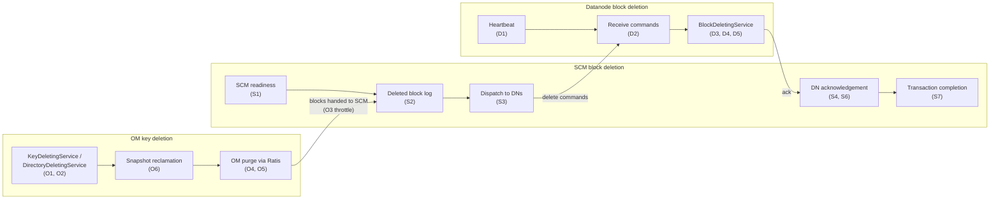

<!--
  Licensed under the Apache License, Version 2.0 (the "License");
  you may not use this file except in compliance with the License.
  You may obtain a copy of the License at

      http://www.apache.org/licenses/LICENSE-2.0

  Unless required by applicable law or agreed to in writing,
  software distributed under the License is distributed on an
  "AS IS" BASIS, WITHOUT WARRANTIES OR CONDITIONS OF ANY KIND,
  either express or implied. See the License for the specific
  language governing permissions and limitations under the License.
-->

This document describes the first diagnoses built on the [Recon Diagnosis Framework](./recon-diagnosis-framework): the three stages of deletion. It explains how deletion was mapped onto the framework, so that it can be used as a template when adding a diagnosis for another service. Read the framework document first for the concepts (component, category, stage, rule, panel, fact) and the verdict logic.

## 1. Summary

Deletion in Ozone crosses three services. A key deleted by a client is first cleaned up by OM, its blocks are then handed to SCM, and SCM tells the Datanodes to remove the block data. When space is not reclaimed, the problem can be in any of the three.

Deletion is diagnosed as three components in one catalog category, *Deletion*:

| Component                   | Display name            | Service  | Covers                                                                          |
| --------------------------- | ----------------------- | -------- | ------------------------------------------------------------------------------- |
| `OMDeletionService`       | OM key deletion         | OM       | KeyDeletingService, DirectoryDeletingService, purge through OM Ratis, snapshots |
| `SCMDeletionService`      | SCM block deletion      | SCM      | Deleted block log, delete commands to Datanodes, acknowledgements, completion  |
| `DatanodeDeletionService` | Datanode block deletion | Datanode | Delete transactions received and blocks removed, per Datanode                   |

An operator who does not know where deletion is stuck can open the three in order: the result page links to the other components of the category.

## 2. The deletion pipeline



1. **OM.** Deleted keys go to the `deletedTable` (and deleted directories to the `deletedDirTable`). KeyDeletingService and DirectoryDeletingService, which run only on the OM
   leader, pick them up, hand the blocks to SCM, and purge the entries through OM Ratis. Keys still referenced by a snapshot cannot be reclaimed until the snapshot is deleted.
2. **SCM.** The blocks become transactions in the deleted block log. SCMBlockDeletingService, which runs only on the SCM leader, sends delete commands to the Datanodes that hold the replicas. A transaction completes when every replica has acknowledged it. SCM skips transactions whose container is still OPEN or does not have enough replicas.
3. **Datanodes.** Each Datanode receives delete transactions, and its BlockDeletingService removes the block data from disk, then acknowledges on the next heartbeat.

## 3. How deletion maps onto the framework

This is the result of the "map the pipeline" step in the framework's guide, and is the part to repeat for a new service.

| Framework decision | Deletion choice                                                                                                                             | Why                                                                                                               |
| ------------------ | ------------------------------------------------------------------------------------------------------------------------------------------- | ----------------------------------------------------------------------------------------------------------------- |
| Components         | One per service: OM, SCM, Datanode                                                                                                          | Each service has its own metrics and its own operator actions. Smaller components keep each result page readable. |
| Category           | `Deletion` for all three                                                                                                                  | They are one pipeline, so they appear together and link to each other.                                            |
| Stages             | The pipeline steps above                                                                                                                    | The pipeline strip then reads as the deletion flow.                                                               |
| Rule order         | Pipeline order inside each component                                                                                                        | The first failing rule is the earliest stage that stopped.                                                        |
| Datanode scope     | Only `DatanodeDeletionService`                                                                                                            | Datanode state is local; OM and SCM are cluster-wide.                                                             |
| Current state      | SCM deleted block summary, Recon OM DB `deletedTable`, Recon node manager                                                                 | Backlogs are more accurate from the source than from a scraped gauge.                                             |
| History            | Prometheus counters from OM `DeletingServiceMetrics`, SCM `ScmBlockDeletingServiceMetrics` and Datanode `BlockDeletingServiceMetrics` | Existing metrics; no new ones were added.                                                                         |
| Leader handling    | OM and SCM counters summed, gauges `max`, timestamps `max`                                                                              | KeyDeletingService and SCMBlockDeletingService run only on the leader.                                            |
| Holding back       | SCM skipped transactions, OM throttled by SCM, keys held by snapshots                                                                       | These are `WARN`s with the reason, not `FAIL`s.                                                               |

## 4. Code layout

All deletion code is in the `org.apache.hadoop.ozone.recon.diagnosis.deletion` package of the `ozone-recon` module.

| Class                                 | Role                                                                                                                                                  |
| ------------------------------------- | ----------------------------------------------------------------------------------------------------------------------------------------------------- |
| `OmDeletionDiagnosisProvider`       | Component `OMDeletionService`.                                                                                                                      |
| `ScmDeletionDiagnosisProvider`      | Component `SCMDeletionService`.                                                                                                                     |
| `DatanodeDeletionDiagnosisProvider` | Component `DatanodeDeletionService`, with Datanode scope.                                                                                           |
| `DeletionDiagnosisSupport`          | Shared constants and helpers: the category name, the troubleshooting guide path, the thresholds, number formatting, and reading Datanodes from Recon. |

Framework pieces that deletion uses:

- `DiagnosisLiveState` readers: `getScmDeletedBlockSummary()` (SCM RPC), `getOmDeletedKeySummary()` (Recon OM DB, through `ReconGlobalMetricsService`) and
  `getDatanodes()` (Recon node manager). These are the same sources behind Recon's `PendingDeletionEndpoint` and `NodeEndpoint`.
- Registration in `DiagnosisModule`, in pipeline order:

  ```java
  providers.addBinding().to(OmDeletionDiagnosisProvider.class);
  providers.addBinding().to(ScmDeletionDiagnosisProvider.class);
  providers.addBinding().to(DatanodeDeletionDiagnosisProvider.class);
  ```

Each provider follows the same shape, which a new provider can copy:

1. `COMPONENT` and every PromQL query as `static final` constants, so tests use the same strings.
2. Stage names as private constants.
3. An immutable list of rules built with `DiagnosisRule.of(id, title, stage, this::checkX)`.
4. An immutable list of panels built with `DiagnosisPanel.of(...)` and `series(...)`.
5. Identity methods (`getComponent`, `getDisplayName`, `getCategory`, ...).
6. `collectFacts`, wrapped in `try`/`catch` so it never throws.
7. One private `checkX(ctx)` method per rule.

## 5. Shared thresholds

All thresholds live in `DeletionDiagnosisSupport` or in the provider, as named constants.

| Constant                   | Value | Used by                                                                                                              |
| -------------------------- | ----- | -------------------------------------------------------------------------------------------------------------------- |
| `MIN_ACK_RATIO`          | 10%   | S4: below this share of acknowledged commands, Datanodes are unresponsive.                                           |
| `FAILURE_RATIO_CRITICAL` | 5%    | S5, D4: at or above this share of failed deletions, the rule fails.                                                  |
| `FAILURE_RATIO_WARNING`  | 1%    | S5, D4: at or above this share, the rule warns.                                                                      |
| `MIN_DRAIN_RATIO`        | 5%    | S8, D6: the backlog must shrink by at least this much over the window.                                               |
| `SERVICE_STALE_SECONDS`  | 900s  | O1, O2: a deleting service not run for this long is considered stopped. That is 15 runs at the default 60s interval. |
| `SNAPSHOT_HELD_RATIO`    | 50%   | O6: at or above this share of not-reclaimable keys, snapshots are holding deletion back.                             |

## 6. SCM block deletion (`SCMDeletionService`)

### 6.1 Rules

`${window}` is the diagnosis window. All counters are `sum(increase(...[${window}]))` across SCMs; the backlog gauge is `max(...)`.

| Rule                   | Stage                      | Signal                                                                                                                  | Result                                                                                           | Verdict                                                                                                     |
| ---------------------- | -------------------------- | ----------------------------------------------------------------------------------------------------------------------- | ------------------------------------------------------------------------------------------------ | ----------------------------------------------------------------------------------------------------------- |
| `S1-safemode`        | SCM readiness              | `max(safe_mode_metrics_scm_in_safe_mode)`                                                                             | FAIL if 1                                                                                        | `SCM_IN_SAFEMODE`                                                                                         |
| `S2-backlog`         | SCM deleted block log      | `getDeletedBlockSummary()` over SCM RPC; fallback `max(scm_block_deleting_service_num_block_deletion_transactions)` | Always PASS: reports the backlog                                                                 | -                                                                                                           |
| `S3-dispatch`        | SCM -> Datanode dispatch   | `..._num_block_deletion_command_sent`, `..._num_skipped_transactions`                                               | SKIPPED if nothing pending. WARN if nothing sent but transactions skipped. FAIL if nothing sent. | `TRANSACTIONS_SKIPPED`, `SCM_NOT_DISPATCHING`                                                           |
| `S4-acknowledged`    | Datanode acknowledgement   | `..._command_success` + `..._command_failure` vs sent; `..._commands_timeout` by Datanode                         | SKIPPED if nothing sent. FAIL if under 10% acknowledged; names Datanodes with timeouts.          | `DATANODE_UNRESPONSIVE`                                                                                   |
| `S5-execution`       | Datanode execution         | `..._transaction_success_on_datanodes`, `..._transaction_failure_on_datanodes`                                      | SKIPPED if no results. FAIL at 5% failed, WARN at 1%.                                            | `DATANODE_DELETE_FAILURES`                                                                                |
| `S6-datanode-health` | Datanode acknowledgement   | Recon node manager                                                                                                      | SKIPPED if nothing pending. WARN if in-service Datanodes are not healthy; names them.            | `DATANODES_UNHEALTHY`                                                                                     |
| `S7-completion`      | SCM transaction completion | `..._transaction_completed` vs `..._command_success`                                                                | SKIPPED if nothing pending or acknowledged. FAIL if acknowledged but none completed.             | `TRANSACTIONS_NOT_COMPLETING`                                                                             |
| `S8-drain`           | End-to-end progress        | backlog now vs `offset ${window}`; created vs completed                                                               | PASS if empty or shrank by 5%. UNKNOWN if no start sample. WARN otherwise.                       | `INTAKE_EXCEEDS_DRAIN` (completing, but slower than intake), `BACKLOG_NOT_DRAINING` (nothing completed) |

Metric names are shortened above; the full names start with `scm_block_deleting_service_` and are listed as constants in `ScmDeletionDiagnosisProvider`.

Points worth copying:

- **S3 checks for intentional skips before failing.** A backlog with no commands sent is a `FAIL` only if SCM did not skip transactions on purpose. If it did, the result is a `WARN`
  that tells the operator to look at OPEN or under-replicated containers.
- **S4 names the hosts.** It maps the `datanode` label of the timeout metric (a UUID) to a hostname with Recon's node list, and falls back to the UUID.
- **S2 shows the fallback pattern.** It reads SCM over RPC and, if that fails, the Prometheus gauge, and records which one it used in `source`.
- **S1 links a specific guide.** It uses `withTroubleshootingPath("safemode")` instead of the deletion guide.

### 6.2 Panels and facts

| Panel                                | Series                                | Healthy looks like                              |
| ------------------------------------ | ------------------------------------- | ----------------------------------------------- |
| Pending deletion transactions        | backlog gauge                         | Flat near zero, or falling after a bulk delete. |
| Transactions created vs completed    | created, completed per minute         | Completed tracks created.                       |
| Delete commands sent vs acknowledged | sent, acknowledged, failed per minute | Acknowledgements follow the commands sent.      |
| Pending deletion size (replicated)   | replicated bytes                      | Space reclaimed once the transactions complete. |

Facts: pending transactions, pending blocks and pending replicated size (from SCM RPC, or the backlog from Prometheus if SCM is not reachable); transactions created and completed in the window; completion rate; backlog change per minute; and the estimated time to drain when the backlog is shrinking.

## 7. OM key deletion (`OMDeletionService`)

### 7.1 Rules

OM `DeletingServiceMetrics` reset when OM restarts; `increase()` treats the drop as a counter reset, so a restart does not look like a stall. Run timestamps take the most recent OM.

| Rule                | Stage                       | Signal                                                                                | Result                                                                                          | Verdict                                    |
| ------------------- | --------------------------- | ------------------------------------------------------------------------------------- | ----------------------------------------------------------------------------------------------- | ------------------------------------------ |
| `O1-kds-running`  | OM KeyDeletingService       | `time() - max(deleting_service_metrics_kds_last_run_timestamp) / 1000`, keys purged | PASS if it ran in the last 900s or purged keys. SKIPPED if no keys are pending. FAIL otherwise. | `KEY_DELETING_SERVICE_NOT_RUNNING`       |
| `O2-dds-running`  | OM DirectoryDeletingService | same for `dds_last_run_timestamp`, directories purged                               | WARN if it has not run for 900s and purged nothing.                                             | `DIRECTORY_DELETING_SERVICE_NOT_RUNNING` |
| `O3-scm-throttle` | OM -> SCM handoff           | `..._num_key_deletion_throttled_by_scm_lag`                                         | WARN if > 0                                                                                     | `KEY_DELETION_THROTTLED_BY_SCM`          |
| `O4-key-purge`    | OM purge (Ratis)            | `..._num_keys_sent_for_purge` vs `..._num_keys_purged`                            | SKIPPED if nothing sent. FAIL if sent but none purged.                                          | `PURGE_NOT_COMPLETING`                   |
| `O5-dir-purge`    | OM purge (Ratis)            | `..._num_dirs_sent_for_purge` vs `..._num_dirs_purged`                            | SKIPPED if nothing sent. FAIL if sent but none purged.                                          | `DIRECTORY_PURGE_NOT_COMPLETING`         |
| `O6-snapshots`    | Snapshot reclamation        | `max(..._aos_keys_not_reclaimable_last)` / `max(..._aos_keys_iterated_last)`      | SKIPPED if no keys iterated. WARN at 50%.                                                       | `KEYS_HELD_BY_SNAPSHOTS`                 |
| `O7-progress`     | End-to-end progress         | Recon OM DB `deletedTable` count, `..._num_keys_processed`                        | UNKNOWN if the Recon OM DB is not available. WARN if keys are pending and none processed.       | `PENDING_KEYS_NOT_PROCESSED`             |

Metric names are shortened above; the full names start with `deleting_service_metrics_`.

Points worth copying:

- **O1 combines history and current state.** It fails only when the service is stale and keys are pending in Recon's OM DB, so an idle cluster is `SKIPPED`, not `FAIL`.
- **O2 is a warning on purpose.** Recon has no cheap count of the `deletedDirTable`, so it cannot tell an idle DirectoryDeletingService from a stopped one.
- **O4 and O5 share one method** (`checkPurge`) with different queries and verdicts. Use this when two stages behave the same way.
- **O7 says the data may lag.** Recon's OM DB replica can be one sync interval behind OM, and the next steps say so.

### 7.2 Panels and facts

| Panel                                          | Series                     | Healthy looks like                                                             |
| ---------------------------------------------- | -------------------------- | ------------------------------------------------------------------------------ |
| Keys sent for purge vs purged                  | sent, purged per minute    | Purged tracks sent.                                                            |
| Directories sent for purge vs purged           | sent, purged per minute    | Purged tracks sent.                                                            |
| Time since the last deleting service run       | KDS, DDS                   | A sawtooth near the service interval; a rising line means the service stopped. |
| Keys reclaimed vs held by snapshots (last run) | reclaimed, not reclaimable | Keys referenced by a snapshot cannot be reclaimed until it is deleted.         |

Facts: pending `deletedTable` entries and pending replicated size (from the Recon OM DB, noted as lagging), keys sent for purge and purged in the window, purge rate, and time since the last KeyDeletingService run.

## 8. Datanode block deletion (`DatanodeDeletionService`)

### 8.1 Rules

Datanode state is local, so each rule is evaluated per Datanode with `byInstance()`, and the Datanodes that fail it are listed as affected. Every query uses `${dn}`, so the same rules work for the whole cluster and for one Datanode. Metric names start with `block_deleting_service_metrics_`.

| Rule                   | Stage                         | Signal                                                                                        | Result                                                                                                                                 | Verdict                                           |
| ---------------------- | ----------------------------- | --------------------------------------------------------------------------------------------- | -------------------------------------------------------------------------------------------------------------------------------------- | ------------------------------------------------- |
| `D1-health`          | Datanode heartbeat            | Recon node manager                                                                            | Scoped: FAIL if the Datanode is not healthy, UNKNOWN if Recon does not know it. Cluster: WARN if in-service Datanodes are not healthy. | `DATANODE_NOT_HEALTHY`, `DATANODES_UNHEALTHY` |
| `D2-receiving`       | SCM -> Datanode dispatch      | `..._received_transaction_count` vs SCM commands sent                                       | SKIPPED if SCM sent nothing. Otherwise, if nothing was received: FAIL for the cluster, WARN for one Datanode.                          | `NOT_RECEIVING_DELETE_COMMANDS`                 |
| `D3-deleting`        | Datanode BlockDeletingService | `min_over_time(..._total_pending_block_count[${window}])` > 0 and `..._success_count` = 0 | FAIL if a Datanode had blocks pending for the whole window and deleted none; names them.                                               | `DATANODE_DELETION_STALLED`                     |
| `D4-failures`        | Datanode BlockDeletingService | `..._failure_count` vs `..._success_count`, per Datanode                                  | SKIPPED if nothing attempted. FAIL at 5% on any Datanode, WARN at 1%.                                                                  | `DATANODE_DELETE_FAILURES`                      |
| `D5-lock-contention` | Datanode BlockDeletingService | `..._total_lock_timeout_transaction_count`                                                  | WARN if > 0 on any Datanode; names them.                                                                                               | `CONTAINER_LOCK_CONTENTION`                     |
| `D6-drain`           | End-to-end progress           | pending now vs `offset ${window}`, for Datanodes that deleted something                     | UNKNOWN if no start sample. WARN if pending did not shrink by 5%.                                                                      | `INTAKE_EXCEEDS_DRAIN`                          |

Points worth copying:

- **D2 changes severity with scope.** One Datanode may legitimately hold no replicas of the deleted blocks, so for one Datanode it is a `WARN`; every Datanode receiving nothing is a
  `FAIL`.
- **D2 reuses a query from another provider** (`ScmDeletionDiagnosisProvider.COMMANDS_SENT`). Queries are shared through constants, not by calling the other provider's rules.
- **D3 uses `min_over_time`** to require a backlog for the *whole* window, so a Datanode that just received work is not reported as stalled.
- **D3 and D6 do not overlap.** D3 reports Datanodes that deleted nothing; D6 only those that delete too slowly. Each problem is reported once.
- **A missing metric is `UNKNOWN`.** The rules read per-Datanode values through a helper, `requireData`, that throws `DiagnosisDataException` when no Datanode reports the metric.

### 8.2 Datanode scope

`supportsDatanodeScope()` returns `true`, so the catalog shows a Datanode picker and the API accepts `datanode=`. The framework resolves the value to the hostname Recon knows and replaces `${dn}` with:

```text
instance=~"(?i)<first-dns-label>(\..+)?(:[0-9]+)?"
```

This matches the short and the fully qualified form of the hostname, with any port, because Prometheus targets and Recon may use different forms. Only a hostname that passed validation and matched a known Datanode is used.

### 8.3 Panels and facts

| Panel                                      | Series                      | Healthy looks like                                      |
| ------------------------------------------ | --------------------------- | ------------------------------------------------------- |
| Blocks pending deletion (top 10 Datanodes) | pending blocks per Datanode | Each line falls back towards zero after deletes arrive. |
| Blocks deleted vs failed                   | deleted, failed per minute  | Deletions while blocks are pending, few or no failures. |
| Delete transactions received from SCM      | received per minute         | Shows whether SCM's commands reach the Datanodes.       |
| Pending deletion size                      | pending bytes               | Space that will be reclaimed.                           |

Facts: blocks pending deletion (and across how many Datanodes), pending size, blocks deleted, space reclaimed and blocks failed in the window.

## 9. Troubleshooting links

The guide lives at `deletion` under the configured troubleshooting base URL. Each provider links its section, and some rules link a more specific anchor.

| Path                                         | Linked by                   |
| -------------------------------------------- | --------------------------- |
| `deletion#om-key-deletion`                 | `OMDeletionService`       |
| `deletion#om-deleting-service-not-running` | O1, O2                      |
| `deletion#om-purge-not-completing`         | O4, O5                      |
| `deletion#keys-held-by-snapshots`          | O6                          |
| `deletion#scm-block-deletion`              | `SCMDeletionService`      |
| `safemode`                                 | S1                          |
| `deletion#transactions-skipped`            | S3 (WARN)                   |
| `deletion#scm-not-dispatching`             | S3 (FAIL)                   |
| `deletion#datanode-unresponsive`           | S4                          |
| `deletion#transactions-not-completing`     | S7                          |
| `deletion#datanode-block-deletion`         | `DatanodeDeletionService` |
| `deletion#datanode-deletion-stalled`       | D3                          |

The guide must provide every anchor in this table.

## 10. Using this as a template

To add a diagnosis for another service, repeat what was done for deletion:

1. **Split by service.** One component per service the pipeline crosses, all in one category.
2. **Write the stages down first** (section 2), then decide for each stage which signal shows
   progress, which shows a backlog, and which shows intentional holding back (section 3).
3. **Copy the provider shape** (section 4): constants for every query, a rule list in pipeline
   order, a panel list, best-effort facts, one method per rule.
4. **Name the thresholds** as constants, with a comment on why the value was chosen (section 5).
5. **Return `SKIPPED` when there is nothing to do**, as S3, S4, O1 and D2 do, so idle clusters
   are healthy.
6. **Report intentional pauses as `WARN`** before reporting a `FAIL`, as S3 and O6 do.
7. **Name the hosts** whenever a rule can tell them apart, as S4, D3 and D4 do.
8. **Avoid reporting one problem twice**, as D3 and D6 do.
9. **Write one test per fault** on top of a healthy `setup()`.
10. **List every troubleshooting anchor** the rules use, and add them to the guide.
