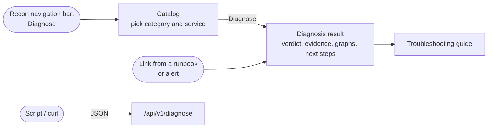
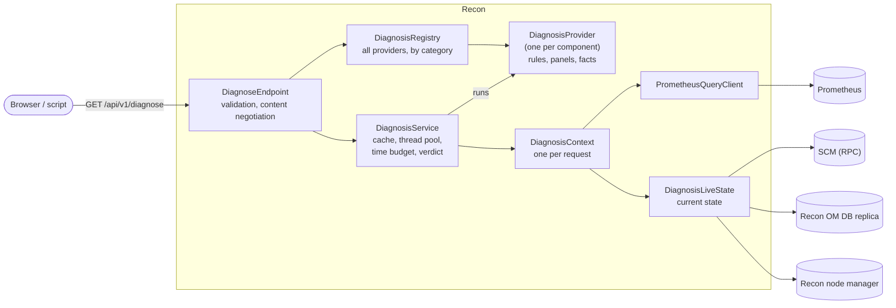
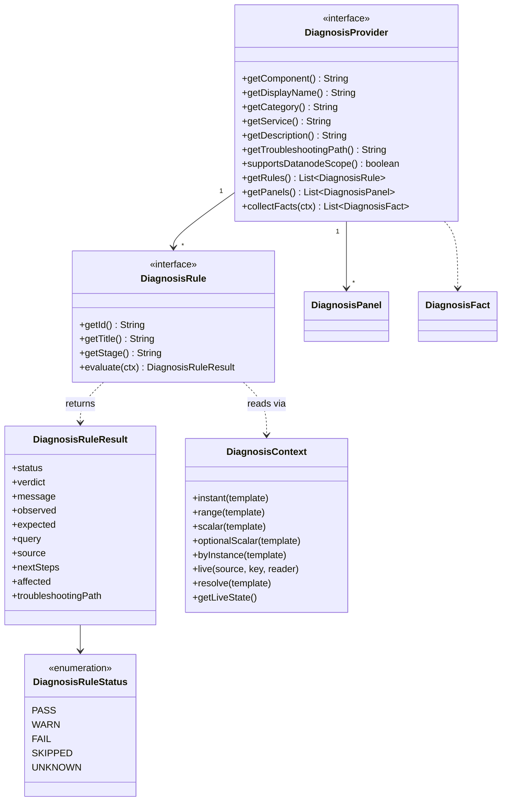
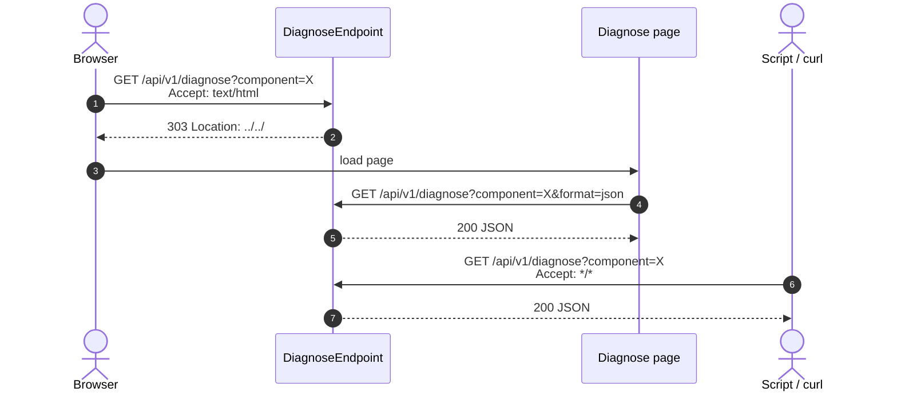
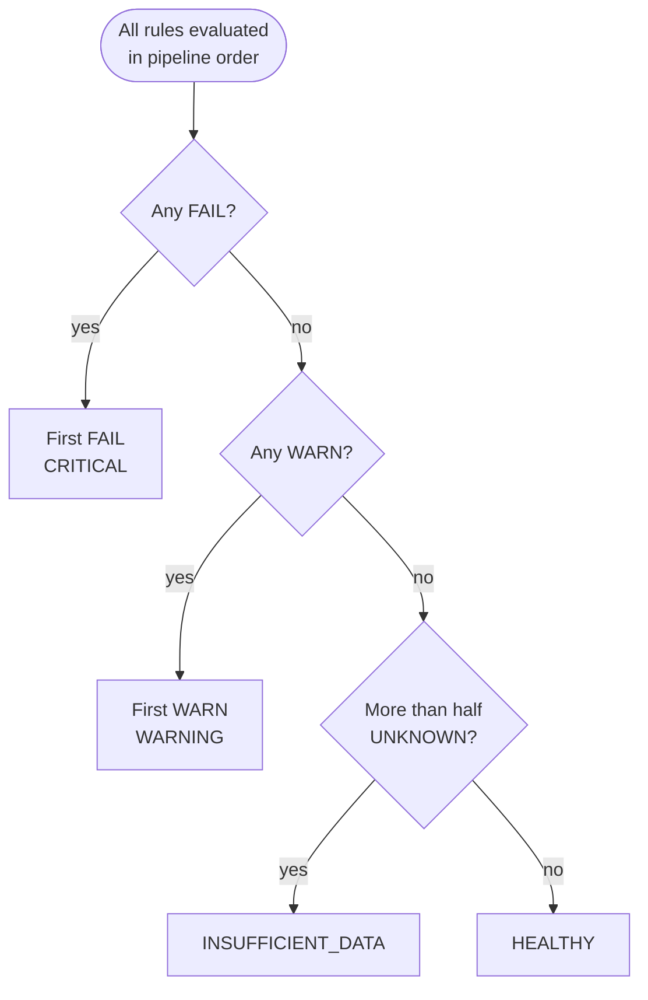
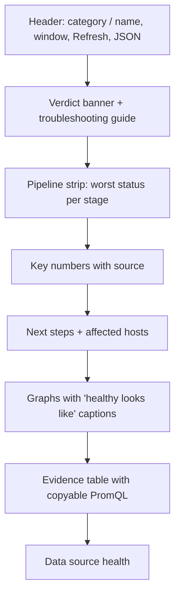
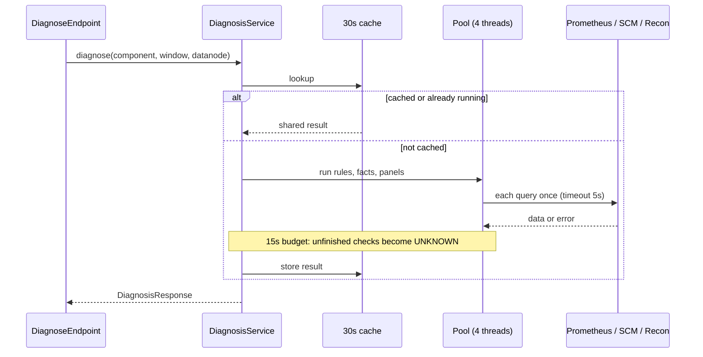

<!--
  Licensed under the Apache License, Version 2.0 (the "License");
  you may not use this file except in compliance with the License.
  You may obtain a copy of the License at

      http://www.apache.org/licenses/LICENSE-2.0

  Unless required by applicable law or agreed to in writing,
  software distributed under the License is distributed on an
  "AS IS" BASIS, WITHOUT WARRANTIES OR CONDITIONS OF ANY KIND,
  either express or implied. See the License for the specific
  language governing permissions and limitations under the License.
-->

This document describes the generic framework: what it does, how it is built, and how to add a diagnosis for a new service. The first diagnoses built on it, for deletion, are described in
[Recon Diagnosis: Deletion](./recon-diagnosis-deletion). Read that document next as a worked example.

## 1. Summary

We propose a **Diagnose** feature in Recon. An operator picks a service, and Recon answers three questions:

- **Where** does it stop making progress? (the stalled stage)
- **Why** do we think so? (evidence, each item with the PromQL query that produced it)
- **What** should I do next? (concrete commands and a link to the troubleshooting guide)

The framework has three parts:

- A REST API, `GET /api/v1/diagnose?component=<name>`, that returns a diagnosis as JSON.
- A **Diagnose** page in the Recon UI, reachable from the navigation bar. It lists the available diagnoses by category and service, and shows the result of the one you pick.
- A plug-in interface, `DiagnosisProvider`. Each diagnosis is one provider class. Adding a provider takes one class and one line of wiring; the API and the UI pick it up without changes.

## 2. Problem

Many Ozone features run as background pipelines that cross services: deletion, replication, container balancing, snapshot cleanup. When one slows down or stops, operators struggle to find out why:

1. **The knowledge is spread out.** Diagnosing a pipeline means knowing many metrics across OM, SCM and the Datanodes: which are gauges and which are counters, which only move on the leader, and how they relate to each other.
2. **Dashboards show data, not conclusions.** A graph can show a flat line, but it cannot say whether that is healthy (nothing to do), expected (the service is holding work back on purpose) or a real stall.
3. **Diagnosis is slow and inconsistent.** Two engineers looking at the same problem can reach different conclusions, because they run different queries at different times.

We want one place in Recon that gives a clear, repeatable answer, built from evidence anyone can re-run, and that service owners can extend with their own knowledge.

## 3. Goals and non-goals

### Goals

- **Name the stalled stage**, with a confidence level and evidence that can be reproduced.
- **Show progress over time.** Graphs over a time window make "stuck" and "progressing slowly" look different.
- **Be easy to find.** Operators start from the Recon navigation bar and pick a diagnosis.
- **One URL for people and scripts.** The same URL opens the page in a browser and returns JSON to `curl`. Runbooks and alerting tools can link to it.
- **Be pluggable.** A new diagnosis needs no framework, endpoint or UI change.
- **Degrade gracefully.** If Prometheus, a metric or SCM is unavailable, only the affected checks become `UNKNOWN`. The rest of the page still renders.
- **Add no new server-side surface.** No new Ozone metrics, RPCs, protobuf messages, RocksDB tables or persistent state.
- **Keep the cost bounded.** Many people opening the same diagnosis must not overload Prometheus or Recon.

### Non-goals

- **Automatic fixes.** Recon recommends actions; it never changes cluster state.
- **Alerting.** Recon does not add alert rules. Existing monitoring keeps doing detection, and can link to a diagnosis.
- **Storing history in Recon.** Prometheus already holds the history; Recon stays stateless.
- **A metrics dashboard.** The Diagnose page shows conclusions, not raw metrics. Grafana remains the tool for exploring metrics.
- **Background evaluation.** A diagnosis runs only when someone asks for it.

## 4. Concepts

| Term                | Meaning                                                                                                                                                          |
| ------------------- | ---------------------------------------------------------------------------------------------------------------------------------------------------------------- |
| **Component** | One diagnosable unit, identified by the `component` parameter, for example `SCMDeletionService`. Each component is implemented by one `DiagnosisProvider`. |
| **Category**  | A group of related components shown together in the catalog, for example *Deletion*.                                                                           |
| **Stage**     | One step of the pipeline a component covers, for example "SCM -> Datanode dispatch". The UI shows one step per stage.                                            |
| **Rule**      | One check of one stage. It returns a status and evidence.                                                                                                        |
| **Panel**     | One graph over the diagnosis window, with a sentence on what healthy looks like.                                                                                 |
| **Fact**      | One headline number, such as a backlog or a rate, with its source.                                                                                               |
| **Verdict**   | The overall answer: the first failing rule's code, `HEALTHY` or `INSUFFICIENT_DATA`.                                                                         |
| **Window**    | The period the diagnosis looks back over, 30 minutes by default.                                                                                                 |

## 5. How it works

### 5.1 User flow



1. The operator opens **Diagnose** from the navigation bar.
2. The page lists the diagnoses, grouped by category and then by service.
3. The operator picks one, optionally sets a time window and a Datanode, and clicks **Diagnose**.
4. Recon runs the rules and shows the verdict, the evidence, graphs and next steps.

### 5.2 Why Recon

A diagnosis needs data from several places. Recon already has all of them:

- a Prometheus client (`MetricsServiceProvider`), for metric history,
- an SCM client, for current SCM state,
- a replica of the OM DB,
- a view of Datanode state,
- authentication and authorization on `/api/v1/*`,
- a UI.

No other Ozone service sees all of these.

## 6. Architecture



The split of responsibilities is simple: **providers know the service, the framework knows everything else.** A provider only describes rules, panels and facts. The framework validates the request, runs the provider, enforces the time budget, picks the verdict, caches the result and renders it.

### 6.1 Components

Framework classes live in `org.apache.hadoop.ozone.recon.diagnosis`; the endpoint lives in `org.apache.hadoop.ozone.recon.api`, and the response types in `org.apache.hadoop.ozone.recon.api.types`.

| Class                      | Role                                                                                                                         | Changed when adding a diagnosis?        |
| -------------------------- | ---------------------------------------------------------------------------------------------------------------------------- | --------------------------------------- |
| `DiagnosisProvider`      | The plug-in interface. Describes one component.                                                                              | Implemented                             |
| `DiagnosisRule`          | One check. `DiagnosisRule.of(...)` builds one from a method reference.                                                     | Used                                    |
| `DiagnosisRuleResult`    | A rule's status and evidence, built with `pass`, `warn`, `fail`, `skipped`, `unknown` and `with...` methods.     | Used                                    |
| `DiagnosisPanel`         | One graph: one or more PromQL series and a "healthy looks like" sentence.                                                    | Used                                    |
| `DiagnosisFact`          | One headline number with a unit (`COUNT`, `BYTES`, `PER_MINUTE`, `SECONDS`, `MINUTES`) and a source.               | Used                                    |
| `DiagnosisContext`       | Per-request access to data: PromQL queries, current state, the window and Datanode scope. Caches every read for the request. | Used                                    |
| `DiagnosisDataException` | Thrown when a query has no data; turns the rule `UNKNOWN` and records the query.                                           | Used                                    |
| `DiagnosisLiveState`     | Readers for current state that Prometheus cannot give reliably, such as SCM RPC results and Recon's OM DB and node manager.  | Extended only if a new source is needed |
| `DiagnosisModule`        | Guice module. Registers providers with a `Multibinder`.                                                                    | One line added                          |
| `DiagnosisRegistry`      | Looks up providers by component and groups them by category.                                                                 | No                                      |
| `DiagnosisService`       | Runs a provider in parallel with a time budget, picks the verdict and confidence, caches the result.                         | No                                      |
| `PrometheusQueryClient`  | PromQL instant and range client on top of `MetricsServiceProvider`.                                                        | No                                      |
| `DiagnoseEndpoint`       | The REST resource.                                                                                                           | No                                      |

Existing Recon pieces that are reused:

- `MetricsServiceProvider` / `PrometheusServiceProviderImpl`, extended with a default `getMetricsRange` method for range queries.
- `StorageContainerLocationProtocol`, the Recon SCM client.
- The Recon OM DB replica (through `ReconGlobalMetricsService`) and the Recon node manager.
- The existing Recon authentication and admin filters.

### 6.2 Provider interface

```java
public interface DiagnosisProvider {
  String getComponent();             // value of ?component=, e.g. SCMDeletionService
  String getDisplayName();           // e.g. "SCM block deletion"
  String getCategory();              // catalog group, e.g. "Deletion"
  String getService();               // OM, SCM, Datanode, ...
  String getDescription();           // one sentence shown in the catalog
  String getTroubleshootingPath();   // relative to the configured base URL
  default boolean supportsDatanodeScope() { return false; }
  List<DiagnosisRule> getRules();    // in pipeline order
  List<DiagnosisPanel> getPanels();  // in display order
  List<DiagnosisFact> collectFacts(DiagnosisContext ctx);  // best effort, never throws
}

public interface DiagnosisRule {
  String getId();                    // stable, e.g. S3-dispatch
  String getTitle();                 // e.g. "Delete commands are dispatched"
  String getStage();                 // pipeline stage this rule checks
  DiagnosisRuleResult evaluate(DiagnosisContext ctx) throws Exception;
  static DiagnosisRule of(String id, String title, String stage, Evaluator e) { ... }
}
```



Notes:

- **Categories** are plain display names, not an enum, so a new category needs no framework change. The catalog shows categories, and the providers inside them, in the order they are registered in `DiagnosisModule`.
- **Rules are independent.** They never call each other and share data only through `DiagnosisContext`, which caches reads so that a query used by two rules runs once.
- **Stages** are plain strings. Several rules can share a stage; the UI shows the worst status of its rules.

### 6.3 Rule statuses

| Status      | Meaning                                                                              | Effect on the verdict                                                 |
| ----------- | ------------------------------------------------------------------------------------ | --------------------------------------------------------------------- |
| `PASS`    | The stage is making progress.                                                        | None.                                                                 |
| `WARN`    | Progress is slow, or held back for a known reason.                                   | Can be the verdict if nothing fails.                                  |
| `FAIL`    | The stage has stopped.                                                               | The first `FAIL` is the verdict.                                    |
| `SKIPPED` | Nothing to do at this stage, so nothing to check.                                    | None, and does not lower confidence.                                  |
| `UNKNOWN` | The rule could not be evaluated: missing data, an error, or the time budget ran out. | Lowers confidence; too many lead to `INSUFFICIENT_DATA`.            |

## 7. REST API

### 7.1 Requests

```text
GET /api/v1/diagnose/components
GET /api/v1/diagnose?component=<name>[&window=30m][&datanode=<host>][&format=json]
```

| Parameter     | Rules                                                                                                                                                                                                                              |
| ------------- | ---------------------------------------------------------------------------------------------------------------------------------------------------------------------------------------------------------------------------------- |
| `component` | Required. Case-insensitive match against registered providers. Unknown values return `400` with the list of valid names.                                                                                                         |
| `window`    | `<n>[s\|m\|h]`, default `30m`, from `5m` to `6h`. The minimum makes sure the window covers several scrapes and service runs.                                                                                                 |
| `datanode`  | Only for providers that support Datanode scope; `400` otherwise. Must match `[A-Za-z0-9][A-Za-z0-9._-]*` **and** a Datanode Recon knows, by full hostname or by first DNS label (case-insensitive, only if unambiguous). |
| `format`    | `json` forces JSON even for a browser.                                                                                                                                                                                           |

### 7.2 Catalog

`GET /api/v1/diagnose/components` returns the list the UI catalog shows. It only reads the
registry and runs no queries, so it is cheap.

```json
{
  "categories": [
    {
      "category": "Deletion",
      "components": [
        { "component": "SCMDeletionService", "displayName": "SCM block deletion", "service": "SCM",
          "description": "...", "supportsDatanodeScope": false,
          "troubleshootingUrl": "https://ozone.apache.org/docs/next/troubleshooting/deletion#scm-block-deletion" }
      ]
    }
  ]
}
```

### 7.3 One URL for browsers and scripts

If a browser opens `/api/v1/diagnose?...` (its preferred type is `text/html`) and `format=json` is not set, Recon replies `303 See Other` and redirects to the UI page. Other clients get JSON.

The redirect target is **relative** (`../../#/Diagnose?...`), so it works behind a reverse proxy and cannot point outside Recon. Parameters are URL-encoded and the UI renders them only as text.



### 7.4 Response

```json
{
  "component": "SCMDeletionService",
  "displayName": "SCM block deletion",
  "category": "Deletion",
  "service": "SCM",
  "generatedAt": "2026-11-12T07:41:12Z",
  "window": "30m", "windowSeconds": 1800,
  "verdict": "DATANODE_UNRESPONSIVE",
  "severity": "CRITICAL",
  "confidence": "HIGH",
  "summary": "SCM sent 5,120 delete commands in the last 30m but datanodes acknowledged only 140 (2.7%).",
  "suspectedStage": "Datanode acknowledgement",
  "troubleshootingUrl": "https://ozone.apache.org/docs/next/troubleshooting/deletion#datanode-unresponsive",
  "facts":    [ { "label": "Pending transactions", "value": 48210, "unit": "COUNT", "source": "scmRpc" } ],
  "evidence": [ { "rule": "S4-acknowledged", "title": "...", "stage": "...", "status": "FAIL",
                  "verdict": "DATANODE_UNRESPONSIVE", "message": "...", "observed": 140,
                  "expected": ">= 10.0% of commands sent", "query": "sum(increase(...[1800s]))",
                  "source": "prometheus", "nextSteps": ["..."], "affected": ["dn-07.example.com"] } ],
  "panels":   [ { "id": "scm-commands", "title": "...", "description": "Healthy: ...", "unit": "PER_MINUTE",
                  "series": [ { "legend": "sent", "query": "...", "samples": [] } ] } ],
  "affected": ["dn-07.example.com"],
  "nextSteps": ["Run 'ozone admin datanode list' ..."],
  "dataSources": { "prometheus": "AVAILABLE", "scmRpc": "AVAILABLE", "reconNodeManager": "AVAILABLE" }
}
```

- `verdict` is a provider code in `UPPER_SNAKE_CASE`, or one of the framework codes `HEALTHY` and `INSUFFICIENT_DATA`.
- `severity` is `CRITICAL`, `WARNING`, `OK` (for `HEALTHY`) or `UNKNOWN` (for `INSUFFICIENT_DATA`).
- `summary`, `suspectedStage` and `nextSteps` come from the rule that set the verdict.
- `affected` is the union of the affected hosts of every `FAIL` and `WARN` rule.
- `datanode` is present only when the diagnosis is scoped to one Datanode; it is the hostname Recon knows, not the value typed in the URL.
- Fields are only ever added; clients must ignore unknown fields.
- This is a new public REST API, so verdict codes and field names become a compatibility contract once released.

## 8. How the verdict is chosen

Rules are ordered by pipeline stage. **All** rules run and all their evidence is returned. Then:

1. If any rule is `FAIL`, the first `FAIL` is the verdict (severity `CRITICAL`).
2. Else, if any rule is `WARN`, the first `WARN` is the verdict (severity `WARNING`).
3. Else, if more than half of the rules are `UNKNOWN`, the verdict is `INSUFFICIENT_DATA` (severity `UNKNOWN`).
4. Else the verdict is `HEALTHY` (severity `OK`).

A real `FAIL` or `WARN` is always reported, even when many other rules are `UNKNOWN`; the low coverage shows up in the confidence instead.



### 8.1 Confidence

| Verdict               | `HIGH`                           | `MEDIUM`                                                      | `LOW`                                      |
| --------------------- | ---------------------------------- | --------------------------------------------------------------- | -------------------------------------------- |
| `FAIL`              | Every stage before it was checked. | An earlier stage is `UNKNOWN`, so it could be the real cause. | More than half of the rules are `UNKNOWN`. |
| `WARN`              | -                                  | Always: a warning is not a confirmed stall.                     | More than half of the rules are `UNKNOWN`. |
| `HEALTHY`           | No rule is `UNKNOWN`.            | Some rules are `UNKNOWN`.                                     | -                                            |
| `INSUFFICIENT_DATA` | -                                  | -                                                               | Always.                                      |

Because `SKIPPED` does not lower confidence, an idle cluster shows `HEALTHY / HIGH`, not a list of `UNKNOWN`s. There is no scoring model: anyone can reproduce a verdict by running the listed queries.

This is why **rule order matters**. The provider lists rules in pipeline order, so the verdict names the earliest stage that stopped, which is usually the cause; later stages often fail only as a consequence.

## 9. Principles for writing rules

- **Judge progress, not size.** A large backlog that is shrinking is healthy. Compare counters over the window (`increase(...[${window}])`) and the value at the start of the window (`offset ${window}`) with the value now. Avoid fixed size thresholds.
- **Missing data is not zero.** Use `scalar()` for signals the rule needs; it throws when there is no data and the rule becomes `UNKNOWN` with its query. A metric renamed between releases then shows up as `UNKNOWN`, not as a false `HEALTHY`.
- **Handle leaders correctly.** For services that run only on the OM or SCM leader:
  - sum counters across instances (`sum(increase(...))`), so progress on any instance counts and a former leader adds nothing;
  - take replicated gauges with `max`;
  - take run timestamps from the most recent instance (`max(...)`).
- **Tolerate restarts.** `increase()` treats a counter drop as a reset, so a restart does not look like a stall.
- **Prefer current state from the source.** Read backlogs from the service over RPC, or from Recon's OM DB replica, when available, with Prometheus as the fallback. Every result and fact carries its source.
- **Tell "holding back" from "stuck".** Some services pause work on purpose. Look for those signals and report a `WARN` with the reason before reporting a `FAIL`.
- **Return `SKIPPED` when there is nothing to do**, for example when nothing is pending.
- **Explain every result.** Attach the observed value, the expected value and the query, so an operator can re-run it.
- **Name the affected hosts** with `withAffected(...)` when a rule can tell which hosts are at fault.
- **Only suggest commands and configuration keys that exist.**
- **Every graph says what healthy looks like**, so an operator who does not know the metric can still read it.

## 10. Adding a diagnosis for a new service

This section uses a hypothetical *SCM container replication* diagnosis as the example. See [Recon Diagnosis: Deletion](./recon-diagnosis-deletion) for a complete, real implementation.

### Step 1: Map the pipeline

Before writing code, write down:

- the **stages** the work passes through, in order;
- for each stage, the **signal** that shows progress (a counter that increases), the signal that shows work is waiting (a backlog), and any signal that shows work is held back on purpose;
- where each signal comes from: a Prometheus metric, an RPC, Recon's OM DB or node manager;
- which signals move only on the leader.

Check every metric name against the `/prom` endpoint of a running cluster.

### Step 2: Choose the component identity

Pick a `component` name (stable, used in URLs and links), a display name, a category and a service. If a related diagnosis already exists, reuse its category so they appear together.
Pick a troubleshooting guide path for the component.

### Step 3: Write the provider

Put the provider in its own sub-package, for example `org.apache.hadoop.ozone.recon.diagnosis.replication`. Keep queries as named constants so tests can reuse them.

```java
@Singleton
public class ScmReplicationDiagnosisProvider implements DiagnosisProvider {

  public static final String COMPONENT = "SCMReplicationManager";

  static final String UNDER_REPLICATED = "max(replication_manager_metrics_under_replicated_container)";
  static final String COMMANDS_SENT =
      "sum(increase(replication_manager_metrics_replicate_container_cmds_sent_total[${window}]))";

  private static final String STAGE_RM = "SCM ReplicationManager";
  private static final String STAGE_DN = "Datanode replication";

  private final List<DiagnosisRule> rules = Collections.unmodifiableList(Arrays.asList(
      DiagnosisRule.of("R1-commands", "Replication commands are sent", STAGE_RM, this::checkCommands),
      DiagnosisRule.of("R2-progress", "Under-replicated containers are fixed", STAGE_DN, this::checkProgress)));

  private final List<DiagnosisPanel> panels = Collections.unmodifiableList(Arrays.asList(
      DiagnosisPanel.of("rm-under-replicated", "Under-replicated containers",
          "Healthy: near zero, or falling after a datanode loss.", DiagnosisFact.Unit.COUNT,
          series("under-replicated", UNDER_REPLICATED))));

  @Override public String getComponent() { return COMPONENT; }
  @Override public String getDisplayName() { return "SCM container replication"; }
  @Override public String getCategory() { return "Replication"; }
  @Override public String getService() { return "SCM"; }
  @Override public String getDescription() { return "Checks that under-replicated containers are repaired."; }
  @Override public String getTroubleshootingPath() { return "replication#scm-replication"; }
  @Override public List<DiagnosisRule> getRules() { return rules; }
  @Override public List<DiagnosisPanel> getPanels() { return panels; }

  @Override
  public List<DiagnosisFact> collectFacts(DiagnosisContext ctx) {
    List<DiagnosisFact> facts = new ArrayList<>();
    try {
      facts.add(new DiagnosisFact("Under-replicated containers", ctx.scalar(UNDER_REPLICATED),
          DiagnosisFact.Unit.COUNT, DiagnosisContext.SOURCE_PROMETHEUS, null));
    } catch (Exception e) {
      // Best effort: the rules report missing data.
    }
    return facts;
  }

  private DiagnosisRuleResult checkCommands(DiagnosisContext ctx) throws Exception {
    double waiting = ctx.scalar(UNDER_REPLICATED);
    if (waiting == 0) {
      return DiagnosisRuleResult.skipped("No container is under-replicated.");
    }
    double sent = ctx.scalar(COMMANDS_SENT);
    if (sent == 0) {
      return DiagnosisRuleResult.fail("REPLICATION_NOT_DISPATCHING",
              String.format("%.0f containers are under-replicated but no command was sent.", waiting))
          .withObserved(sent).withExpected("> 0").withQuery(ctx.resolve(COMMANDS_SENT))
          .withSource(DiagnosisContext.SOURCE_PROMETHEUS)
          .withNextSteps("Run 'ozone admin scm roles' to confirm there is an SCM leader.");
    }
    return DiagnosisRuleResult.pass(String.format("SCM sent %.0f replication commands.", sent))
        .withObserved(sent).withExpected("> 0").withQuery(ctx.resolve(COMMANDS_SENT))
        .withSource(DiagnosisContext.SOURCE_PROMETHEUS);
  }

  private DiagnosisRuleResult checkProgress(DiagnosisContext ctx) throws Exception { ... }
}
```

The metric names above are illustrative only.

Things to get right:

- **Rule IDs** are stable and short: a letter for the component, a number for the order and a name, such as `R1-commands`. They appear in the evidence and in bug reports.
- **Verdict codes** are `UPPER_SNAKE_CASE`, describe the problem (`REPLICATION_NOT_DISPATCHING`), and are part of the API once released.
- **`collectFacts` must not throw.** Catch exceptions and leave the fact out.
- **Rules may throw.** Any exception makes only that rule `UNKNOWN`; `DiagnosisDataException` also records the query.
- **Troubleshooting links.** `getTroubleshootingPath()` is the default guide for the component. A rule can point at a more specific anchor with `withTroubleshootingPath(...)`; when that rule sets the verdict, its link is used.

### Step 4: Add current-state readers, if needed

If a rule needs current state that Prometheus cannot give, add a reader method to `DiagnosisLiveState` that wraps an existing Recon client or service, and read it through `ctx.live(source, key, () -> ctx.getLiveState().yourReader())`. Use one of the existing source names (`scmRpc`, `reconOmDb`, `reconNodeManager`) or add a new constant to `DiagnosisContext`, so the page can show whether the source worked. Do not add new RPCs for this.

### Step 5: Support Datanode scope, if it makes sense

If operators need to diagnose one Datanode at a time, return `true` from `supportsDatanodeScope()` and add `${dn}` to the matcher of every per-Datanode query, for example `my_metric{${dn}}`. The catalog then shows a Datanode picker for the component, and the endpoint
validates the hostname before it reaches PromQL.

### Step 6: Register the provider

Add one line to `DiagnosisModule`:

```java
providers.addBinding().to(ScmReplicationDiagnosisProvider.class);
```

The registration order decides the order in the catalog. The new component now appears in the catalog under its category, and in `/api/v1/diagnose/components`.

### Step 7: Write tests

Write one test class per provider, with one test per fault, using `FakePrometheus` (a fake Prometheus that returns fixed values for given query templates) and a mocked `DiagnosisLiveState`:

```java
FakePrometheus prometheus = new FakePrometheus(1800, null)
    .scalar(ScmReplicationDiagnosisProvider.UNDER_REPLICATED, 12)
    .scalar(ScmReplicationDiagnosisProvider.COMMANDS_SENT, 0);
DiagnosisResponse response = new DiagnosisService(prometheus.client(), liveState, new OzoneConfiguration())
    .diagnose(new ScmReplicationDiagnosisProvider(), 1800, null);
assertEquals("REPLICATION_NOT_DISPATCHING", response.getVerdict());
```

Cover at least: a healthy cluster, an idle cluster (`SKIPPED`), each `FAIL` and `WARN` verdict, and Prometheus not configured.

### Step 8: Write the troubleshooting guide

Add a page under the troubleshooting section of the documentation, with one anchor for each path the provider and its rules link to. Each anchor explains what the verdict means and what to check.

### Checklist

- [ ] Rules are in pipeline order and each has a stage.
- [ ] Every rule attaches its query, observed and expected value.
- [ ] Missing data makes a rule `UNKNOWN`, never `PASS`.
- [ ] Idle stages return `SKIPPED`.
- [ ] Intentional pauses are reported as `WARN` with the reason.
- [ ] Leader-only signals are summed or maxed across instances.
- [ ] Affected hosts are named where possible.
- [ ] Every panel has a "healthy looks like" description.
- [ ] Next steps use commands and configuration keys that exist.
- [ ] One test per fault, plus healthy, idle and no-Prometheus cases.
- [ ] Troubleshooting anchors exist for every linked path.

## 11. UI

A new route, `#/Diagnose`, is added to the v2 Recon UI, with a *Diagnose* entry in the navigation bar. It has two views:

| URL                                                       | View                                                |
| --------------------------------------------------------- | --------------------------------------------------- |
| `#/Diagnose`                                            | **Catalog**: pick a category and a service.   |
| `#/Diagnose?component=<name>[&window=..][&datanode=..]` | **Result**: the diagnosis for that component. |

All state is in the URL, so a link pasted into a ticket shows the same view. The UI renders only
what the API returns, so a new provider or category needs no UI change.

### 11.1 Catalog

```text
Diagnose
Pick a service to see where it stops making progress.
[Filter by category, service or name]

<Category>
┌─────────────────────────┐ ┌─────────────────────────┐
│ <Display name> <Service>│ │ <Display name> <Service>│
│ <Description>           │ │ <Description>           │
│                         │ │ Datanode: [All      v]  │
│ Window: [30m v]         │ │ Window:   [30m      v]  │
│              [Diagnose] │ │              [Diagnose] │
└─────────────────────────┘ └─────────────────────────┘
```

- One section per category; one card per component with its name, service and description.
- Each card has a window selector (15m to 6h, default 30m). If the component supports Datanode scope, it also has a Datanode picker filled from `/api/v1/datanodes` (empty = whole cluster).
- **Diagnose** opens the result view with the chosen options.
- A filter box searches by category, service and name.
- The catalog is built from `/api/v1/diagnose/components` only. It runs no diagnosis.

### 11.2 Result



Each part of the page comes from one part of the provider:

| Page section                               | Comes from                                                                                         |
| ------------------------------------------ | -------------------------------------------------------------------------------------------------- |
| Header, *Also in &lt;category&gt;* links | `getDisplayName()`, `getCategory()`, `getService()`, and the other providers in the category |
| Verdict banner                             | The verdict rule's message, stage and troubleshooting link                                         |
| Pipeline strip                             | `getStage()` of each rule, in rule order                                                         |
| Key numbers                                | `collectFacts()`                                                                                 |
| Next steps, affected hosts                 | The verdict rule's next steps; affected hosts of all failing and warning rules                     |
| Graphs                                     | `getPanels()`                                                                                    |
| Evidence table                             | Every rule's result                                                                                |
| Data sources                               | Which sources the request used and whether they worked                                             |

If the component in the URL is unknown, the page shows the error and a link to the catalog.

## 12. Cost, failures and security



### 12.1 Bounded cost

- Rules, facts and panels run on a shared pool of 4 threads. The same query in one request runs only once.
- Every PromQL query has a server-side `timeout=5s`.
- Each request has a 15s budget. Rules not finished by then become `UNKNOWN`.
- Results are cached for 30s per (component, window, Datanode). Identical requests that arrive together share one evaluation.

### 12.2 Failures

- Without Prometheus, history-based rules become `UNKNOWN` and the verdict is usually `INSUFFICIENT_DATA`. Current-state numbers are still shown.
- `dataSources` reports each source as `AVAILABLE`, `PARTIAL`, `UNAVAILABLE` or `NOT_CONFIGURED`.
- An exception in one rule makes only that rule `UNKNOWN`.

### 12.3 Security

- Read-only. The endpoint uses Recon's existing authentication and admin filters on `/api/v1/*`.
- All parameters are validated (section 7.1).
- PromQL templates are fixed in code. Only the window and a validated Datanode label are inserted, which prevents PromQL injection.
- The browser redirect is relative and URL-encoded, so it cannot be used as an open redirect.

## 13. Configuration

| Key                                                | Default                                                | Purpose                                                                                                       |
| -------------------------------------------------- | ------------------------------------------------------ | ------------------------------------------------------------------------------------------------------------- |
| `ozone.recon.diagnosis.troubleshooting.base.url` | `https://ozone.apache.org/docs/next/troubleshooting` | Base URL of the troubleshooting guides. Can point to versioned docs or a local mirror.                        |
| `ozone.recon.prometheus.http.endpoint`           | (existing)                                             | Needed for history-based rules. The Docker Compose `monitoring.conf` sets it to `http://prometheus:9090`. |

Each troubleshooting link is the base URL plus a provider or rule path.

## 14. Alternatives considered

| Alternative                                    | Why not                                                                                                                                             |
| ---------------------------------------------- | --------------------------------------------------------------------------------------------------------------------------------------------------- |
| **Grafana dashboards only**              | They show raw data but no verdict, cannot read SCM RPC or the OM DB, and need expertise to interpret.                                               |
| **Prometheus alert rules**               | Good for detecting a problem, but they cannot combine current RPC state with history and give no structured evidence. They complement this feature. |
| **A CLI (`ozone admin ... diagnose`)** | Useful for scripts, but the JSON API already serves scripts, and the UI serves people. A CLI can wrap the API later.                                |
| **A separate endpoint per service**      | Each would repeat validation, caching, verdict logic and UI. A plug-in interface pays off from the second diagnosis.                                |
| **A scoring or ML model**                | Cannot be explained or reproduced. Operators need to see *why* and re-run the query.                                                              |
| **New "stuck" metrics in each service**  | Needs changes in every service. Progress can already be derived from existing counters.                                                             |

## 15. Implementation plan

| Phase              | Scope                                                                                                                                                                                                   |
| ------------------ | ------------------------------------------------------------------------------------------------------------------------------------------------------------------------------------------------------- |
| 1. Framework       | Provider interfaces, `DiagnosisContext`, `DiagnosisService` (verdict, cache, budget), `PrometheusQueryClient`, `getMetricsRange`, Guice registry and catalog, `DiagnoseEndpoint`, unit tests. |
| 2. First diagnoses | Deletion, see [Recon Diagnosis: Deletion](./recon-diagnosis-deletion).                                                                                                                                   |
| 3. UI              | `#/Diagnose` route with catalog and result views, navigation bar entry, types.                                                                                                                        |
| 4. Docs            | Troubleshooting guides with the anchors the rules link to, and a Prometheus endpoint in the compose monitoring setup.                                                                                   |
| 5. Follow-ups      | A test that scrapes `/prom` from a mini cluster and checks that every metric used by a rule exists; more diagnoses (replication, container balancer, snapshots).                                      |

## 16. Compatibility

- No protobuf, RPC, RocksDB or metric changes. The REST endpoint and UI route are new.
- `MetricsServiceProvider` gets a default method, so existing implementations still work.
- `PrometheusServiceProviderImpl` must accept integer timestamps, which range queries can return.
- If metric names change between Ozone versions, the affected rules return `UNKNOWN` with their query instead of a wrong verdict.
