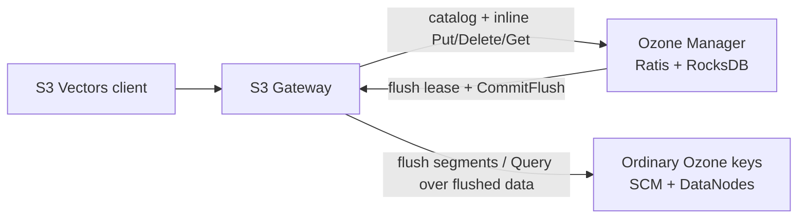

<!--
  Licensed under the Apache License, Version 2.0 (the "License");
  you may not use this file except in compliance with the License.
  You may obtain a copy of the License at

   http://www.apache.org/licenses/LICENSE-2.0

  Unless required by applicable law or agreed to in writing, software
  distributed under the License is distributed on an "AS IS" BASIS,
  WITHOUT WARRANTIES OR CONDITIONS OF ANY KIND, either express or implied.
  See the License for the specific language governing permissions and
  limitations under the License. See accompanying LICENSE file.
-->

# S3 Vectors Design

## Background

Amazon S3 Vectors is a separate AWS service (`s3vectors`) for vector
buckets, indexes, upserts, deletes, listing, and nearest-neighbor
queries. Ozone is a good place to offer the same API on-prem:

- S3 Gateway already scales out as a mostly stateless front door
- Ozone Manager already gives strong consistency through Ratis and RocksDB
- SCM and DataNodes already store durable immutable objects

There is no vector-search implementation in the Ozone codebase today.
[HDDS-14967](https://issues.apache.org/jira/browse/HDDS-14967) is the
open design epic. [HDDS-16503](https://issues.apache.org/jira/browse/HDDS-16503)
is a complementary track: use Ozone as object storage under LanceDB
(no native `s3vectors` API required).

This document proposes a phased native implementation that keeps early
merges safe for `master`. It builds on HDDS-14967 and adjusts the ANN
plan (exact first, pure-Java before any JNI / SPFresh) in response to
feedback already on that ticket.

## Goals

- Support the Amazon S3 Vectors control and data APIs needed for common
  clients, including at least:
  Create/Delete/Get/List vector buckets and indexes,
  PutVectors, DeleteVectors, GetVectors, ListVectors, QueryVectors
  (full operation list is in the AWS / botocore `s3vectors` model)
- Keep request handling and search compute on S3 Gateway
- Make recent writes durable through OM Raft without allocating
  DataNode blocks on every small upsert
- Flush older data into ordinary Ozone objects; Query must still see
  that data
- Reuse SigV4 and existing secure-mode expectations
- Ship behind a feature flag so clusters that leave it off are unchanged

## Non-goals (first phases)

- DataNode-native vector indexes or SCM format changes for vectors
- Full-text search, hybrid BM25+vector search, and AWS `ENHANCED`
  index-mode features (pre-filter richness / text search config).
  MVP targets basic vector similarity + simple metadata filters
- Cross-index transactions
- A separate indexing service outside S3 Gateway / OM
- Replacing HDDS-16503; LanceDB-on-Ozone can continue on its own

## Use cases

- Apps that already speak S3 Vectors and want the same API against Ozone
- Storing embeddings next to source objects already in Ozone
- Warm / infrequent queries where sub-second search is enough
- Operators who only need Ozone as durable object storage under an
  external engine such as LanceDB — that remains HDDS-16503

## Proposed architecture

### Roles

| Component | Responsibility |
| --- | --- |
| S3 Gateway | `s3vectors` HTTP API, query planning, optional local cache, flush build/upload under OM lease |
| Ozone Manager | Vector bucket/index catalog, bounded inline write buffer, flush leases |
| SCM / DataNodes | Store flushed segment objects as normal keys/blocks. No vector-aware DN logic in early phases |

### Why this split

Ozone already separates protocol (S3G), metadata (OM), and bytes (DN).
Vector search should follow that. Putting ANN build and Query on S3G
keeps OM out of heavy CPU work. Putting recent writes in OM gives
read-your-own-write across gateways after Raft commit. Flushing to
normal objects reuses replication, EC, and existing ops tooling.

## Wire protocol

Verified against the public AWS API and the botocore / aws-sdk-go-v2
`s3vectors` models:

| Fact | Source |
| --- | --- |
| Signing name / endpoint prefix is `s3vectors` | botocore `metadata.signingName` / Go SDK default |
| Protocol is JSON over HTTP (`rest-json`) | botocore `protocol` |
| Ops use root paths such as `POST /PutVectors`, `POST /CreateIndex`, `POST /QueryVectors` | botocore `http.requestUri` |
| AWS hosts are like `s3vectors.<region>.api.aws` | AWS regions/endpoints docs |
| Distance metrics are only `euclidean` and `cosine` | `CreateIndex` / `DistanceMetric` enum |
| PutVectors signing uses payload SHA-256 middleware | aws-sdk-go-v2 `addComputePayloadSHA256` |

### Ozone choices (not AWS facts)

- Serve `s3vectors` on the **same S3 Gateway HTTP(S) listener** as
  today’s `s3` API. Clients point a custom endpoint at that listener.
  AWS uses a separate hostname; Ozone multiplexes by SigV4 service name.
- New JAX-RS resources under `org.apache.hadoop.ozone.s3` so
  `GatewayApplication` package scan picks them up
  (`packages("org.apache.hadoop.ozone.s3")`).
- Register **literal** paths (`/PutVectors`, `/CreateIndex`, …).
  Today `BucketEndpoint` is `@Path("/{bucket}")`. Literal paths must
  outrank that template so `/PutVectors` is not treated as a bucket
  named `PutVectors`. This is an implementation requirement, not an
  open product question.
- For service `s3vectors`, payload verification must use the client’s
  `x-amz-content-sha256` header (same idea as service `s3`).

  Today `AWSSignatureProcessor.getPayloadHash` only special-cases
  service `"s3"`. Any other service name, including `s3vectors`, falls
  through to the STS-style path that reads the body and rejects payloads
  larger than `OZONE_S3G_STS_PAYLOAD_HASH_MAX_VALUE` (32768 bytes).
  PutVectors batches will exceed that. Implementation must extend the
  S3-style header path to `s3vectors` (or equivalent) before enabling
  the API.

Accepting `s3vectors` must not break existing `s3` traffic on the same
gateway.

## Data model

### Catalog (OM)

New RocksDB column families (names indicative):

- Vector bucket / index metadata
- Inline vector records for recent upserts
- Delete markers / tombstones for recent deletes
- Flush lease and segment manifest pointers

Do not store vector payloads in `keyTable` / `fileTable`. Keep vector
state in dedicated CFs so normal object traffic and vector traffic do
not share the same hot tables.

Mark a bucket as a vector bucket with a boolean (or similar) on
`OmBucketInfo`. Do **not** add a new `BucketLayout` value.
`BucketLayout` today is only `FILE_SYSTEM_OPTIMIZED`, `OBJECT_STORE`,
and `LEGACY`. Vector-vs-object is a different axis from layout.

### Inline buffer bounds

OM must not become an unbounded vector store.

- Soft and hard limits per index (bytes and/or vector count). Exact
  numbers TBD and published after soak tests
- Soft limit triggers background flush
- Hard limit rejects Put until flush catches up (fail the request;
  do not block the OM raft thread on a synchronous flush)
- Overwrite of an existing vector key updates inline state; deletes are
  tombstones until compaction removes them from flushed segments

### Flushed segments

**Decision:** store segment objects under a **reserved prefix inside the
vector bucket** (for example `.vector-segments/`). Same bucket quota and
encryption settings as the vector data. A separate system volume would
add authz and quota machinery for little gain in phase 1–2.

When a flush runs:

1. S3G (or a designated worker) takes an OM flush lease for an index
2. Reads a contiguous inline range from OM
3. Writes one or more immutable segment objects under the reserved prefix
4. Calls OM `CommitFlush` so the manifest advances and inline rows can
   be dropped

End users must not Put/Delete/Get/List reserved-prefix keys through
normal S3 object APIs.

Flush crash recovery: only OM lease + `CommitFlush` make a flush
durable. A crashed S3G leaves an expired lease and optionally orphan
objects that GC can clean later. Local S3G cache is never the source of
truth.

## Query path

### Phase 1 (MVP)

`QueryVectors` runs **exact** top-K over:

1. The OM inline buffer, and
2. Any committed flushed segments (brute-force read of segment payloads)

Flushed data must remain visible. A design that flushes out of OM and
then hides those vectors from Query until ANN lands is not acceptable.

Supported distance metrics for MVP: `cosine` and `euclidean` only
(AWS parity). There is no AWS dot-product metric.

Metadata filters for MVP: simple exact / basic predicates on filterable
keys. Full AWS `ENHANCED` filter operators and full-text are out of
scope for MVP.

### Phase 2

Same visibility rules, but replace brute-force segment scan with ANN:

1. Search inline (exact or small-index)
2. ANN search over flushed segments
3. Merge and re-rank to top-K
4. Apply deletes / tombstones

ANN library choice stays open until dependency review. Preference order:

1. Pure-Java library under Apache License (JVector is Apache-2.0 and is
   one candidate — not a commitment)
2. Small in-house HNSW if dependency review rejects external options
3. Native / SPFresh only if measured need justifies JNI and ops cost

This deliberately softens the current HDDS-14967 text that names SPFresh
as the on-disk ANN. Exact first, then pure Java, answers the hardware /
JNI concerns raised on that ticket without blocking the API.

### Phase 3

- Compaction / rebalance of segments
- Cache tuning across S3G instances
- Index-level authz / Ranger if needed
- Recon metrics and UI
- Optional full-text / hybrid / `ENHANCED`-style filters later

## Authz and security

- Reuse existing S3 Gateway SigV4 and S3 secret / Kerberos flows
- MVP authorization is bucket-level ACL (and Ranger bucket policies where
  configured). Creating indexes and writing vectors needs the same
  permission as writing the bucket
- Reserved segment prefixes are denied for user Put/Delete/Get/List
- Anonymous access stays rejected in secure mode, same as the rest of S3G
- **Encryption:** flushed segment objects can use existing bucket
  encryption / TDE like other keys. Inline vectors live in OM RocksDB;
  that is **not** the same as object TDE. Inline at-rest protection
  follows whatever the operator already uses for OM disks / OM DB, unless
  a later phase adds something stronger. Do not claim object TDE covers
  the inline buffer

## Observability

Add S3G and OM metrics for:

- Put / Delete / Query latency and error rates
- Inline buffer bytes and vector count per index
- Flush lag, flush failures, lease expiries
- Query path (inline vs segment scan vs ANN) once multiple paths exist

Audit vector APIs through the existing S3G / OM audit paths.

## Feature flag and compatibility

- Cluster config flag, default off
- Gate new OM request types with `OzoneManagerVersion` so mixed-version
  upgrades do not apply unknown vector transactions on old followers
- Disabling the flag after enablement should reject new vector APIs
  cleanly; data already written remains readable for admin recovery

## Alternatives considered

| Option | Pros | Cons | Decision |
| --- | --- | --- | --- |
| Native S3 Vectors on S3G + OM inline + flush | API portability, RYW, fits Ozone planes | More S3G/OM work | **Chosen** |
| LanceDB / external engine only (HDDS-16503) | Less Ozone hot-path risk, value sooner for some users | No native `s3vectors` API | Keep as parallel track |
| Embed Lucene in OM | Familiar ANN stack | Heavy dependency, wrong lifecycle for OM | Reject for OM; Lucene ideas only as reference |
| DN-native vector indexes | Possible local speed | Breaks layering, large SCM/DN blast radius | Reject for early phases |
| Client-side ANN over normal keys | Tiny server change | No S3 Vectors compat, weak multi-tenant ops | Reject as product answer |
| Unbounded OM inline vectors | Simple writes | OM memory / RocksDB blow-up | Reject; hard bounds required |
| SPFresh / JNI from day one | Potentially strong on-disk ANN | HW, JNI, and ops cost before API exists | Defer until measured need |
| Separate system volume for segments | Stronger isolation | Extra authz/quota complexity | Reject for early phases; use reserved prefix in the vector bucket |

## Implementation plan

Each step should be separately reviewable and feature-flagged.

1. Feature flag + `OzoneManagerVersion` gate
2. Extend SigV4 handling so service `s3vectors` uses header-based
   `x-amz-content-sha256` (do not use the 32 KiB STS body-hash path)
3. OM catalog CFs + vector-bucket marker on `OmBucketInfo`
4. OM protocol for catalog and inline Put/Delete/Get/List
5. S3G literal-path endpoints for `s3vectors` ops (must beat `/{bucket}`)
6. Inline Put/Delete/Get/List end to end
7. Exact Query over inline + committed segments
8. Flush lease + segment write + CommitFlush (Query already sees segments)
9. Compaction v0 (drop tombstoned vectors from old segments)
10. Replace segment brute-force with pure-Java ANN
11. Recon metrics
12. Soak tests and published limits

HDDS-16503 work can proceed in parallel and does not depend on the ANN
phases above.

## Open questions

1. Vector CFs in Ozone snapshots later?
2. Phase 2 ANN dependency after LICENSE review (JVector vs in-house)

## References

- [HDDS-14967](https://issues.apache.org/jira/browse/HDDS-14967) S3 Vector Support
- [HDDS-16503](https://issues.apache.org/jira/browse/HDDS-16503) Ozone as LanceDB storage backend
- [AWS S3 Vectors](https://docs.aws.amazon.com/AmazonS3/latest/userguide/s3-vectors.html)
- [PutVectors API](https://docs.aws.amazon.com/AmazonS3/latest/API/API_S3VectorBuckets_PutVectors.html)
  (`POST /PutVectors`)
- [CreateIndex API](https://docs.aws.amazon.com/AmazonS3/latest/API/API_S3VectorBuckets_CreateIndex.html)
  (`distanceMetric`: `euclidean | cosine`)
- botocore `s3vectors` service model (`signingName`, `rest-json`, operation URIs)
- [aws-sdk-go-v2 PutVectors](https://github.com/aws/aws-sdk-go-v2/blob/service/s3vectors/v1.6.2/service/s3vectors/api_op_PutVectors.go)
  (`addComputePayloadSHA256`)
- Ozone `AWSSignatureProcessor.getPayloadHash` (service `"s3"` vs STS 32 KiB path)
- Ozone `GatewayApplication` package scan; `BucketEndpoint` `@Path("/{bucket}")`
- Ozone `BucketLayout` enum (`FILE_SYSTEM_OPTIMIZED`, `OBJECT_STORE`, `LEGACY`)
- [Ozone Enhancement Proposals](./ozone-enhancement-proposals.md)
- Ceph RGW S3 Vectors work (LanceDB-backed): https://github.com/ceph/ceph/pull/66066
